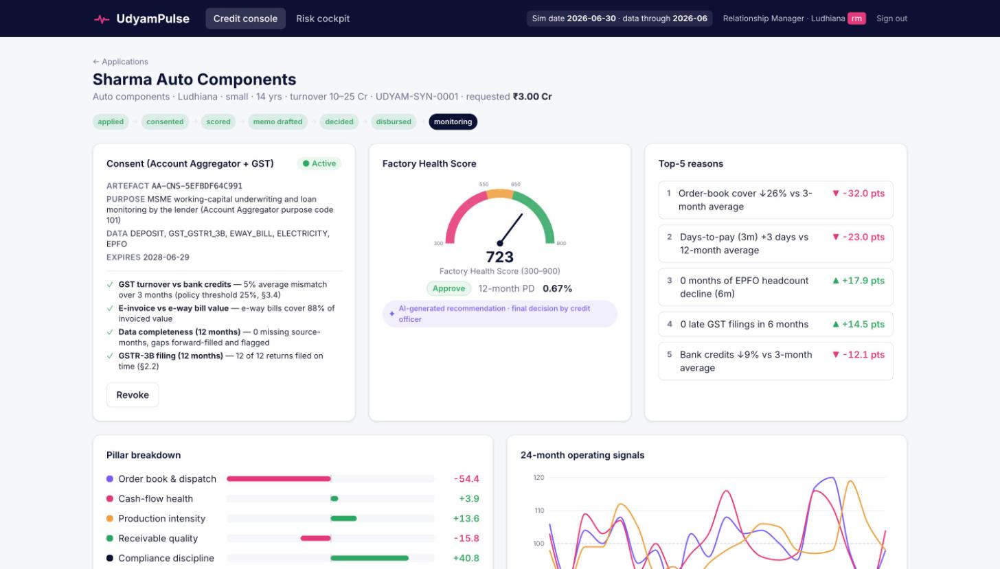
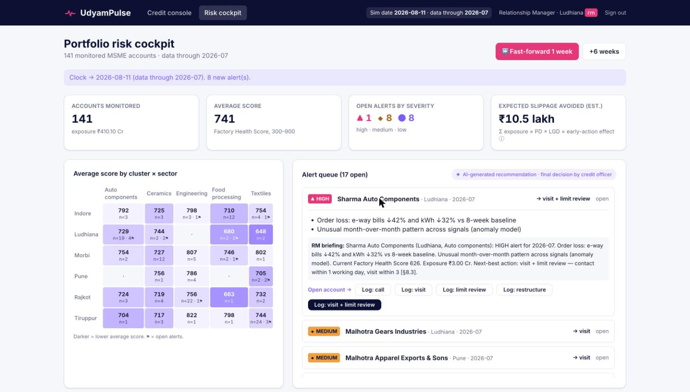
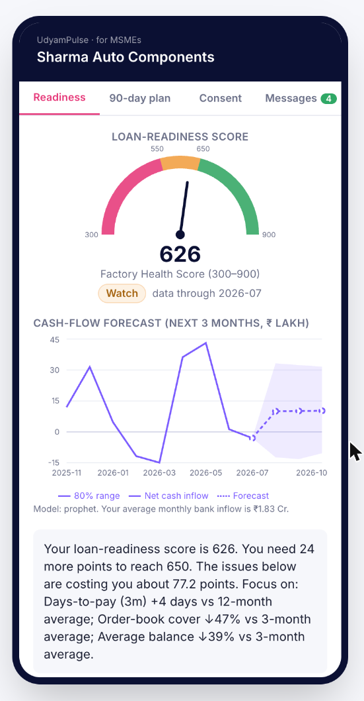
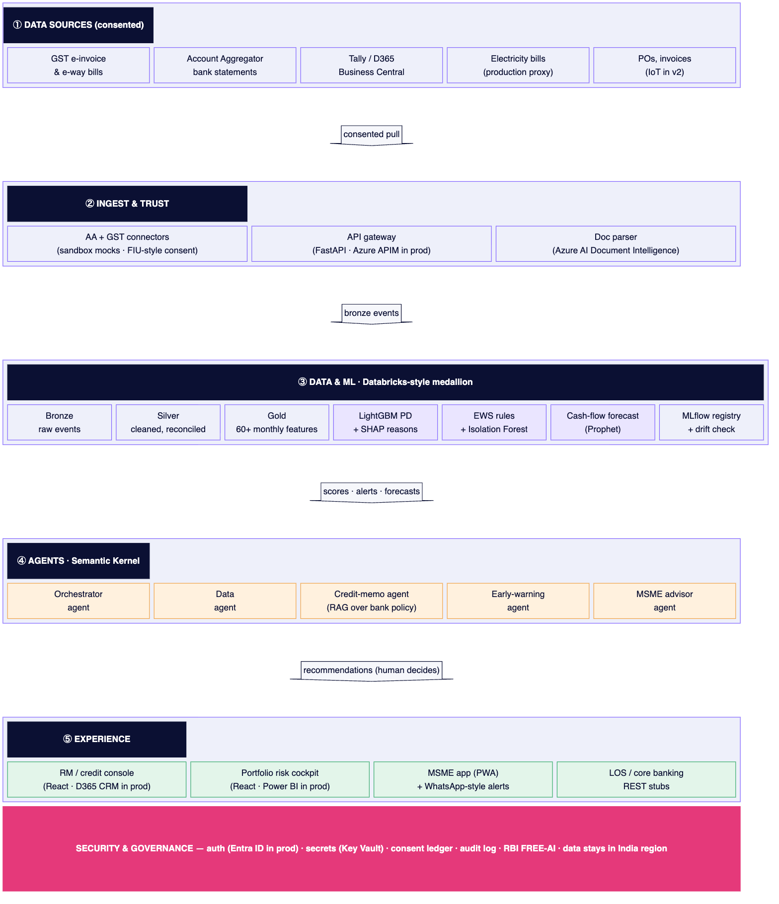
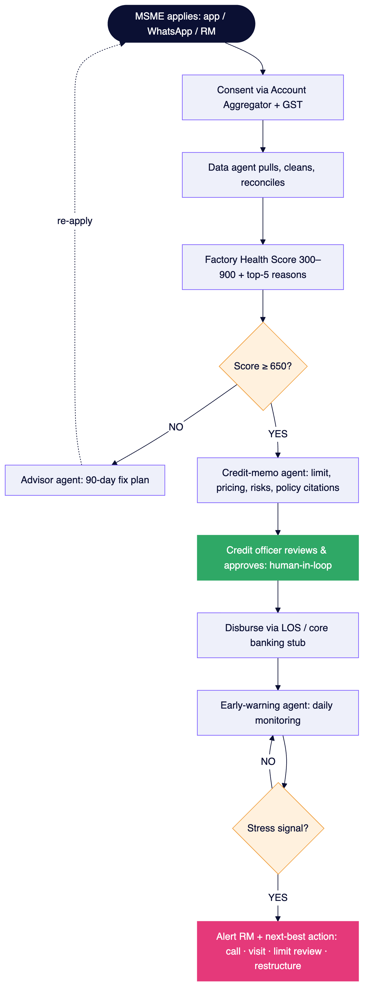

<div align="center">

# UdyamPulse

### Credit backed by your production, not your property.

**A decision-intelligence platform that helps banks lend to small manufacturers based on how their factory is actually running, and warns them early if a borrower starts to struggle.**

[](https://github.com/yugh88/UdyamPulse/actions/workflows/ci.yml)


Visionet Talent Quest 2026 · Techthon · Data and Decision Intelligence (BFSI)
**Team Legit · VIT Bhopal University**

</div>

---

## Contents

1. [The problem](#1-the-problem)
2. [Our solution in one minute](#2-our-solution-in-one-minute)
3. [See it](#3-see-it)
4. [Run it on your machine](#4-run-it-on-your-machine)
5. [Demo walkthrough (5 minutes)](#5-demo-walkthrough-5-minutes)
6. [How it works](#6-how-it-works)
7. [Results](#7-results)
8. [Trust, safety and compliance](#8-trust-safety-and-compliance)
9. [Project structure](#9-project-structure)
10. [Configuration and Azure](#10-configuration-and-azure)
11. [Testing](#11-testing)
12. [Troubleshooting](#12-troubleshooting)
13. [Glossary](#13-glossary)
14. [Limitations and next steps](#14-limitations-and-next-steps)

---

## 1. The problem

India has over six crore MSMEs, and many small manufacturers cannot get a fair bank loan. Banks mostly ask:
*"What property can you pledge?"* and *"What did your balance sheet say last year?"*

That approach misses the point for a factory:

- 🏭 **A busy factory with no spare property** gets rejected, even though it ships goods every day.
- 📄 **Annual financials are old news.** By the time a bank sees them, the business may already be very different.
- ⏰ **Banks find out about trouble too late.** They usually notice only when EMIs stop, when the account is already a Special Mention Account (SMA) and close to becoming a bad loan.

Yet the evidence of a healthy (or struggling) factory already exists every month in digital form: GST invoices,
e-way bills for every truck that leaves the gate, bank-account cash flows, the electricity meter and payroll filings.

## 2. Our solution in one minute

UdyamPulse reads that live evidence, **with the MSME's consent**, and turns it into decisions a bank can act on.

| Step | What happens | Who benefits |
|---|---|---|
| **1. Consent** | The MSME agrees to share data through India's **Account Aggregator** network and GST. The purpose is stated clearly, and consent can be withdrawn with one tap. | MSME stays in control |
| **2. Score** | A machine-learning model reads 67 signals and gives a **Factory Health Score from 300 to 900**, with the **top 5 reasons in plain English**. | Credit officer understands *why* |
| **3. Credit memo** | An AI agent drafts the credit memo: recommended loan limit, interest band, risks, conditions, and citations from the bank's policy. **It never invents a number**: every figure comes from the model or the database. | Hours of paperwork become seconds |
| **4. Human decision** | Only a **credit officer** can approve or reject. The system only recommends. | Accountability stays with the bank |
| **5. Early warning** | After the loan, the platform keeps watching. If orders, electricity use or cash flow drop sharply, it raises an **alert about 3 months before** the loan would normally show trouble, and suggests the next step (call, visit, limit review, restructure). | Bank acts early; MSME gets help early |
| **6. Advice to the MSME** | The MSME sees its own score, a 3-month cash-flow forecast and a **90-day improvement plan**, also available in Hindi. | MSME knows how to become loan-ready |

> **In short:** banks lend based on *production*, not *property*, and spot stress months earlier.

## 3. See it

| Credit console (bank staff) | Risk cockpit (portfolio) | MSME app (mobile) |
|:---:|:---:|:---:|
|  |  |  |
| Score gauge, top-5 reasons, pillar breakdown, consent status | Portfolio KPIs, cluster × sector heat-map, alert queue with RM briefings | Loan-readiness score, cash-flow forecast, 90-day plan, consent control |

### Architecture



Five layers, from bottom-up evidence to front-end decisions, wrapped in a security and governance layer.
Details: [`docs/ARCHITECTURE.md`](docs/ARCHITECTURE.md).

### Loan lifecycle

<p align="center"></p>

---

## 4. Run it on your machine

Everything runs **locally and offline**. You do **not** need any API key, cloud account or real data.

### 4.1 Prerequisites

| Tool | Version | Check with | Install |
|---|---|---|---|
| Python | 3.11 or newer | `python3 --version` | [python.org](https://www.python.org/downloads/) or `brew install python@3.11` |
| Node.js | 20.19 or newer | `node --version` | [nodejs.org](https://nodejs.org/) or `nvm install 20` |
| make | any | `make --version` | Preinstalled on macOS/Linux. On Windows use WSL, or follow [4.3](#43-without-make-windows-or-manual) |
| libomp *(macOS only)* | any | `brew list libomp` | `brew install libomp` (needed by LightGBM) |

### 4.2 One command

```bash
git clone https://github.com/yugh88/UdyamPulse.git
cd UdyamPulse
make demo
```

The first run installs dependencies (a few minutes). After that, `make demo`:

1. **Generates data:** 500 synthetic factories × 24 months of signals.
2. **Builds the data lake:** cleans and joins the data, then computes 67 features per factory per month.
3. **Trains the model** and writes the model card plus fairness and drift reports.
4. **Back-tests the early-warning system** on historical stress events.
5. **Seeds the database** with demo users, 140 monitored loans and 4 new applications.
6. **Starts the app:** API on `http://localhost:8000`, website on **http://localhost:5173**.

Steps 1–5 take about **20 seconds**. Open **http://localhost:5173** and click a persona to sign in.
Every demo password is `demo123`.

| Persona | Username | What they can do |
|---|---|---|
| Relationship Manager | `rm1` | Open applications, request consent, run scoring, draft memos, act on alerts |
| Credit Officer | `co1` | Everything the RM can, plus **approve or reject** (the only role allowed to) |
| Risk team | `risk1` | Portfolio cockpit, model card, fairness and drift, **full audit log** |
| MSME owner | `sharma` | Own readiness score, forecast, 90-day plan, consent control, messages |

Press `Ctrl + C` to stop. Run `make seed` any time to reset the demo to its starting point.

### 4.3 Without make (Windows or manual)

```bash
python3 -m venv .venv
source .venv/bin/activate            # Windows: .venv\Scripts\activate
pip install -r requirements.txt

python -m data_gen.generate          # 1. synthetic data
python -m data_gen.lake              # 2. data lake + features
python -m ml.train                   # 3. model
python -m ml.ews                     # 4. early-warning back-test
python -m api.seed                   # 5. demo database

uvicorn api.main:app --port 8000     # terminal 1: API
cd web && npm install && npm run dev # terminal 2: website → http://localhost:5173
```

### 4.4 With Docker

```bash
docker compose up --build                     # API :8000 + web :5173
docker compose --profile https up --build     # optional: HTTPS through Caddy at https://localhost
```

### 4.5 Useful commands

| Command | What it does |
|---|---|
| `make help` | List every command |
| `make demo` | Build everything and start the app |
| `make seed` | Reset the demo database and clock |
| `make api` / `make web` | Start only the API or only the website |
| `make test` | Run the 29 automated tests |
| `make lint` | Check Python (ruff) and TypeScript |
| `make openapi` | Export the API specification to `docs/openapi.json` |
| `make clean` | Delete generated data, models and the database |

---

## 5. Demo walkthrough (5 minutes)

The story follows **Sharma Auto Components, Ludhiana**, a small auto-parts maker asking for a ₹3 Cr working-capital loan.
The app has a **simulated clock** starting on 30 June 2026, so you can "fast-forward" weeks during the demo.

| # | Sign in as | Click | What you should see |
|---|---|---|---|
| 1 | **RM** | *Credit console* → **Sharma Auto Components** → *Request consent & pull data* | Consent becomes **Active**; four data checks pass (GST vs bank, invoices vs e-way bills, completeness, filings). |
| 2 | RM | *Run scoring* | Score **723 · Approve**, 12-month default probability 0.67%, top-5 reasons, pillar bars, 24-month signal chart. |
| 3 | RM | *Generate memo* → *Preview PDF* | A full credit memo in under a second: limit **₹3.00 Cr**, pricing **EBLR + 2.50–3.00%**, strengths, risks, covenants, policy citations such as **[§4.1]**. |
| 4 | **Credit Officer** | Open the application → write a comment → **Approve** → **Disburse via LOS** | Key Fact Statement appears; the loan moves to *Monitoring*. (An RM trying to approve gets "not allowed".) |
| 5 | Credit Officer or RM | *Risk cockpit* → **+6 weeks** | Sharma's biggest buyer cuts orders: **e-way bills ↓42%, electricity ↓32%**. |
| 6 | RM | Open the **HIGH** alert | Reasons, an RM briefing and the suggested action **"visit + limit review"**; log the action with one click. |
| 7 | **MSME** (`sharma`) | *Readiness* → *90-day plan* (toggle **हिंदी**) → *Consent* → **Revoke** | Score has dropped to **626 · Watch**, with a forecast and an action plan. After revoking, the app shows that data pulls have stopped. |
| 8 | **Risk** | *Governance* | Every action in the audit log, the model card, and fairness and drift checks. |

Presenter notes and a recording checklist: [`docs/DEMO_SCRIPT.md`](docs/DEMO_SCRIPT.md).

---

## 6. How it works

### 6.1 The data (synthetic, realistic)

`data_gen/generate.py` creates **500 factories across 5 industrial clusters** (auto parts in Ludhiana, engineering in Rajkot,
textiles in Tiruppur, ceramics in Morbi, food processing in Indore). Each factory gets 24 months of the signals a bank
would see with consent:

| Source | Signals |
|---|---|
| GST e-invoices and returns | invoice count and value, top-buyer share, days-to-pay, filing delay |
| E-way bills | count and value of goods shipped |
| Account Aggregator (bank) | money in, money out, average balance, cheque/NACH bounces |
| Electricity | kWh consumed (a direct proxy for production) |
| ERP / Tally | raw-material purchases, open purchase orders |
| EPFO | employee headcount |

About **12% of factories** experience a hidden **stress event**: the top buyer cuts orders, payments get delayed, or
money is diverted. Some recover; others default a few months later. The realistic ranges and the noise (missing months,
duplicates, mismatches) are documented in [`data_gen/CALIBRATION.md`](data_gen/CALIBRATION.md).
**No real company or person appears anywhere.**

### 6.2 From raw data to features (data lake)

We follow the **bronze → silver → gold** pattern used on Databricks, built locally with **DuckDB**:

- **Bronze:** raw events per source, exactly as received.
- **Silver:** duplicates removed, gaps filled and flagged, GST turnover reconciled against bank credits.
- **Gold:** **67 features** per factory per month over 1, 3, 6 and 12-month windows, for example
  *"e-way bill value vs 3-month average"* or *"cheque bounces in the last 6 months"*.

Features are grouped into **five pillars**:

| Pillar | Weight | Example question it answers |
|---|---|---|
| Order book & dispatch | 25% | Are orders and shipments growing or shrinking? |
| Cash-flow health | 25% | Is more money coming in than going out? Any bounces? |
| Production intensity | 20% | Is the factory actually running (electricity, raw material)? |
| Receivable quality | 15% | Does it depend on one buyer? Are buyers paying late? |
| Compliance discipline | 15% | Are GST and EPFO filings on time? |

### 6.3 The Factory Health Score

- A **LightGBM** model predicts the **probability of default within 12 months (PD)**.
- It is trained on earlier months and tested on **later months it has never seen**, the way a bank would use it.
- PD is converted to a **score from 300 to 900** (higher is safer):

| Score | Band | Meaning |
|---|---|---|
| **650 – 900** | 🟢 Approve | Credit officer may sanction |
| **550 – 649** | 🟠 Watch | Reduced limit plus conditions |
| **300 – 549** | 🔴 High risk | Decline, and offer an improvement plan |

- **SHAP** explains every score: each feature's contribution is converted into *score points*, so the top-5 reasons
  and the pillar bars add up exactly to the final score.

### 6.4 The early-warning system

After disbursal, every month of new data is checked against **five rules** (editable in [`ml/rules.yaml`](ml/rules.yaml)) plus an anomaly detector:

| Rule | Fires when |
|---|---|
| Order loss | e-way bills ↓40% **and** electricity ↓30% vs the last 8 weeks |
| Cash squeeze | 2+ bounces in a month, **or** balance ↓50% in 30 days |
| Buyer risk | top buyer > 50% of sales **and** buyers paying 20+ days slower |
| Possible diversion | GST turnover and bank credits differ by > 25% |
| Compliance slip | GST return late 2 months in a row |
| Anomaly (Isolation Forest) | an unusual combination of month-on-month changes |

Fired rules are combined into a **severity** (low, medium, high) and a **next-best action** (call, visit, limit review, restructure).

### 6.5 The AI agents

| Agent | Job |
|---|---|
| **Orchestrator** | Runs the loan journey `APPLIED → CONSENTED → SCORED → MEMO_DRAFTED → DECIDED → DISBURSED → MONITORING` and blocks invalid steps |
| **Data agent** | Requests Account Aggregator consent, pulls data only while consent is active, runs reconciliation checks |
| **Credit-memo agent** | Finds relevant clauses in the bank's [credit policy](policy/credit_policy.md) (RAG), fills in numbers from the model, writes the memo, exports a PDF |
| **Early-warning agent** | Turns rule hits into alert cards with an RM briefing and a next step |
| **MSME advisor agent** | Builds a 90-day plan from the score reasons and the cash-flow forecast (Prophet), in simple English and Hindi |

**No API key needed.** By default the agents use a deterministic **template writer**. If you add Azure OpenAI keys,
the prose is written by GPT through **Semantic Kernel**. A **number guard** then rejects any sentence containing a
number that does not appear in the source data, and falls back to the template.

### 6.6 Tech stack

| Layer | Prototype (runs locally) | Production (Azure, same interfaces) |
|---|---|---|
| API | FastAPI, Pydantic v2 | Azure API Management |
| Data lake | Parquet + DuckDB | Azure Databricks, Delta Lake, Unity Catalog |
| Database | SQLite (SQLAlchemy) | Azure Database for PostgreSQL |
| ML | LightGBM, SHAP, scikit-learn, Prophet, MLflow | Databricks MLflow |
| Agents and LLM | Semantic Kernel, template fallback | Azure OpenAI / Foundry Agent Service |
| Policy search | TF-IDF + FAISS | Azure AI Search |
| Frontend | React, Vite, TypeScript, Tailwind, Recharts (PWA) | Dynamics 365, Power BI Embedded |
| Auth | JWT with 4 roles | Microsoft Entra ID |
| Ops | Docker Compose, Makefile, GitHub Actions | AKS, Key Vault, Azure Monitor (India regions) |

---

## 7. Results

All results are on **synthetic data**, measured on months the model never saw during training.

| What we measured | Target | Result | What it means |
|---|---|---|---|
| Model accuracy (AUC) | ≥ 0.80 | **0.81** | The model ranks a future defaulter above a healthy firm 81% of the time |
| Default rate inside each band | increasing | Approve **1.5%** · Watch **5.8%** · High risk **51.8%** | The bands separate risk clearly |
| Early-warning lead time | ≥ 60 days | **91 days** (median) | Alerts arrive about 3 months before a loan reaches SMA-2 |
| Early-warning recall | high | **22 of 22** SMA-2 cases caught | No stressed borrower slipped through in the back-test |
| Early-warning precision | — | **49%** of alerted firms had real stress | Some false alarms, which is why a human reviews each alert |
| Credit memo speed | < 10 s | **~0.3 s** | — |
| Invented numbers in memos | 0 | **0** (enforced by a test) | — |

Full reports: [`ml/MODEL_CARD.md`](ml/MODEL_CARD.md) and [`ml/reports/`](ml/reports/) (metrics, fairness, drift, early-warning back-test).

> These numbers show the pipeline works end to end. Real performance must be re-measured on a lender's real,
> consented data before any production use.

---

## 8. Trust, safety and compliance

| Principle | How it is built in |
|---|---|
| **Human decides** | Only the `credit_officer` role can approve or reject, and a written comment is mandatory |
| **Explainable** | Every score shows its top-5 reasons and pillar contributions |
| **Honest AI** | Every AI output is labelled *"AI-generated recommendation · final decision by credit officer"* |
| **No made-up numbers** | The LLM only writes prose; a guard rejects any unsupported number |
| **Consent first** (DPDP Act 2023) | Clear purpose, consent ledger, one-tap revoke, automatic deletion of fetched data |
| **Right to challenge** | The MSME can press *Request a human review* |
| **Digital lending rules** (RBI 2025) | Key Fact Statement, direct disbursal to the borrower, no biometrics, data stays in India |
| **Fair** | Disparity checks across sectors and micro vs small units; no gender, religion or caste data exists |
| **Auditable** | Every agent action is logged with user, time, masked inputs and a hash of the output; only the risk team can read the log |

Full mapping to RBI Digital Lending Directions 2025, the DPDP Act and RBI FREE-AI: [`docs/COMPLIANCE.md`](docs/COMPLIANCE.md).

---

## 9. Project structure

```
UdyamPulse/
├── data_gen/        synthetic data generator, CALIBRATION.md, DuckDB lake builder
├── lake/            bronze/ silver/ gold/ data (created by make; not in git)
├── ml/              features, model training, scoring, early warning (+ rules.yaml), forecast,
│                    MODEL_CARD.md, reports/
├── agents/          orchestrator, data, credit-memo, early-warning and advisor agents
│   └── providers/   swappable adapters: LLM, policy search, consent, data lake, document parser
├── api/             FastAPI app, routes, database models, login/roles, audit log, demo seed
├── policy/          sample bank credit policy (the memo agent cites this)
├── web/             React app: credit console, risk cockpit, MSME app, governance
├── docs/            ARCHITECTURE.md, COMPLIANCE.md, DEMO_SCRIPT.md, openapi.json, images/
├── tests/           automated tests
├── Makefile         one-command workflow
└── docker-compose.yml
```

### Main API endpoints

Interactive docs at **http://localhost:8000/docs** while the API is running.

| Method | Endpoint | Purpose | Who |
|---|---|---|---|
| POST | `/auth/login` | Get a login token | everyone |
| POST | `/applications` | Create a loan application | RM, MSME |
| POST / DELETE | `/applications/{id}/consent` | Grant or revoke consent | RM, MSME |
| POST | `/applications/{id}/score` | Score + reasons + pillars | RM, credit officer |
| POST | `/applications/{id}/memo` | Draft the credit memo (JSON + PDF) | RM, credit officer |
| POST | `/applications/{id}/decision` | Approve or reject | **credit officer only** |
| POST | `/applications/{id}/disburse` | Disburse through the LOS stub | credit officer, RM |
| GET | `/portfolio` | All monitored loans with score and trend | bank staff |
| GET / POST | `/alerts`, `/alerts/{id}/action` | Alert queue and logging an action | bank staff |
| POST | `/sim/advance?days=7` | Fast-forward the simulated clock | bank staff |
| GET | `/msme/{factory_id}/readiness` | Score, forecast and 90-day plan | MSME, RM |
| GET | `/audit` | Full audit trail | **risk only** |

---

## 10. Configuration and Azure

Configuration comes from environment variables; copy `.env.example` to `.env` to change them.
**Every setting defaults to the local, offline option.**

| Variable | Default | Production option |
|---|---|---|
| `UP_LLM_PROVIDER` | `template` | `azure_openai` (set the `AZURE_OPENAI_*` keys) |
| `UP_SEARCH_PROVIDER` | `local` | `azure_ai_search` |
| `UP_CONSENT_PROVIDER` | `mock_aa` | `sahamati_aa` |
| `UP_LAKE_STORE` | `duckdb` | `databricks` |
| `UP_DOC_PARSER` | `stub` | `azure_docintel` |
| `UP_DATA_REGION` | `local` | `centralindia` / `southindia` (the API refuses non-India regions) |

Every Azure service sits behind a Python interface (`LLMProvider`, `SearchProvider`, `ConsentProvider`, `LakeStore`,
`DocParser`), so moving to Azure means switching a setting rather than rewriting the app.

---

## 11. Testing

```bash
make test    # 29 tests, about 7 seconds
make lint    # ruff + TypeScript type-check
```

| Test file | Proves that |
|---|---|
| `tests/test_scoring.py` | 60+ features exist; the score mapping is monotonic and bounded; SHAP points add up to the score; AUC ≥ 0.80 |
| `tests/test_ews.py` | Each early-warning rule fires only when it should; the demo factory gets a HIGH alert; lead time ≥ 60 days |
| `tests/test_api_roles_consent.py` | Only credit officers can approve; every step is in the audit log; revoking consent blocks data pulls |
| `tests/test_memo.py` | Memo is under 10 s with ≥ 2 citations and **no number missing from the source facts**; invented LLM numbers are rejected |

GitHub Actions runs linting, the full data/model pipeline, the tests, the web build and dependency scans on every push.

---

## 12. Troubleshooting

| Problem | Fix |
|---|---|
| `Library not loaded: libomp.dylib` (macOS) | `brew install libomp`, then rerun |
| `pip install` fails on `prophet` | Upgrade pip (`pip install -U pip`) and use Python 3.11 or 3.12 |
| Vite says Node is too old | Install Node 20.19+ (`nvm install 20`) |
| `Port 5173/8000 is already in use` | Stop the other process, or run `make api` / `make web` separately after freeing the port |
| Login fails in the browser | The API is not running; start it with `make api` and check http://localhost:8000/health |
| Demo state is messy after practice | `make seed` resets the database and the clock to 30 Jun 2026 |
| Score/alerts look different from this README | Run `make clean && make demo` to rebuild from the fixed seed (42) |

---

## 13. Glossary

| Term | Meaning |
|---|---|
| **MSME** | Micro, Small and Medium Enterprise. *Udyam* is the government's MSME registration. |
| **GST e-invoice** | A sales invoice reported to the government's GST system in real time. |
| **E-way bill** | A permit generated whenever goods worth over ₹50,000 move by road, so it tracks real dispatches. |
| **Account Aggregator (AA)** | RBI-regulated network that lets a person or business share bank data with a lender, with explicit consent. |
| **EPFO** | Employees' Provident Fund Organisation; its filings show how many people a firm employs. |
| **PD** | Probability of Default: the chance a borrower stops paying within 12 months. |
| **SMA-0 / 1 / 2** | Special Mention Account: a loan 1–30, 31–60 or 61–90 days overdue. SMA-2 is the last stage before a bad loan (NPA). |
| **NPA** | Non-Performing Asset: a loan more than 90 days overdue. |
| **AUC** | Model-quality measure from 0.5 (random) to 1.0 (perfect). |
| **SHAP** | A method that shows how much each input pushed a prediction up or down. |
| **RAG** | Retrieval-Augmented Generation: the AI looks up the relevant policy text before writing. |
| **EBLR** | External Benchmark Lending Rate; MSME loan interest is set as EBLR + a spread. |
| **KFS** | Key Fact Statement: a one-page summary of the loan's total cost, which RBI requires before signing. |
| **LOS** | Loan Origination System: the bank's core system that books and disburses loans. |
| **TReDS** | Online platforms where MSMEs can sell unpaid invoices to get paid faster. |
| **DPDP Act** | Digital Personal Data Protection Act, 2023, India's data-privacy law. |
| **FREE-AI** | RBI's Framework for Responsible and Ethical Enablement of AI in finance. |

---

## 14. Limitations and next steps

**Prototype limits**

- All data is synthetic, so real performance must be re-measured on a lender's consented data.
- Monthly signals only; weekly e-way bill and electricity data would make warnings even earlier.
- Account Aggregator, GST, LOS and Azure services are mocked behind interfaces, not live integrations.

**Next steps**

1. Pilot with one lender in one cluster (for example Ludhiana auto parts) on real consented data.
2. Plug in live Account Aggregator (Sahamati) and GST sandbox connectors.
3. Move the lake to Azure Databricks and the agents to Azure OpenAI in the Central India region.
4. Add IoT machine-uptime signals and WhatsApp Business notifications for MSMEs.

---

<div align="center">

**Team Legit · VIT Bhopal University** · Visionet Talent Quest 2026

*Prototype for demonstration. Uses synthetic data only. Not a lending product. All credit decisions remain with the regulated lender.*

</div>
