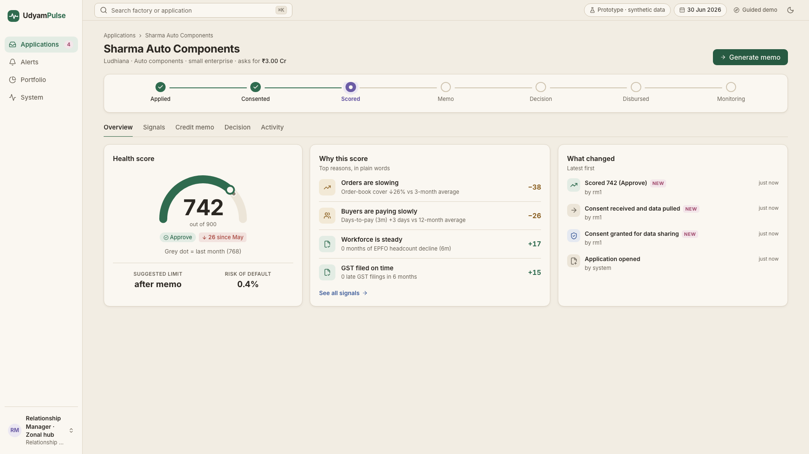
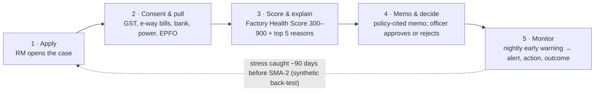
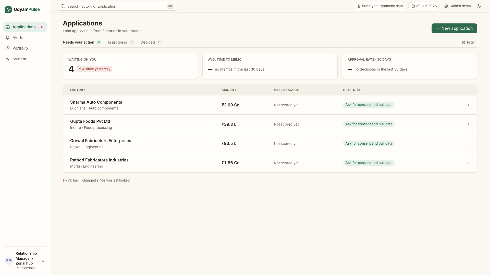
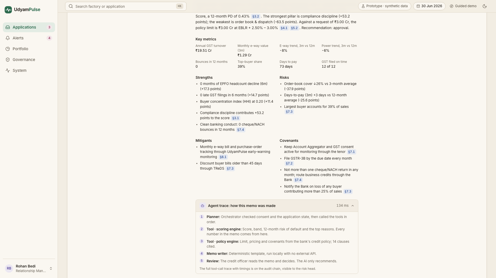
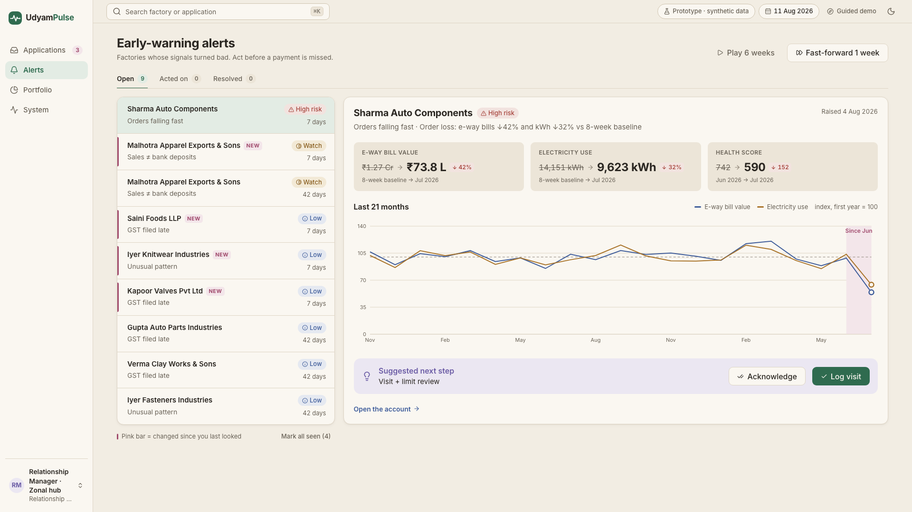
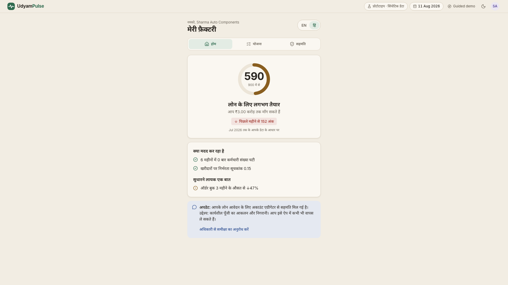
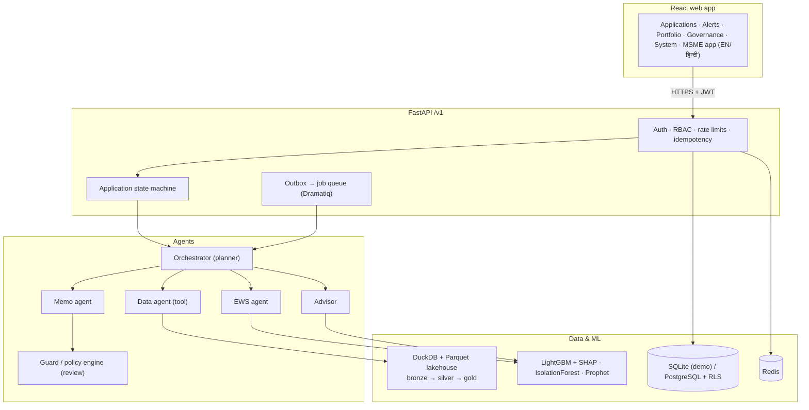

<div align="center">

# UdyamPulse

### Credit backed by your production, not your property.

**Helps banks lend to small manufacturers based on how their factory actually runs, and warns them early when a borrower starts to struggle.**

[](https://github.com/yugh88/UdyamPulse/actions/workflows/ci.yml)
[](https://udyampulse-demo.onrender.com)


Visionet Techthon 2026 · Round 2 · BFSI: Data & Decision Intelligence · **Team Legit, VIT Bhopal University**

**[▶ Open the live demo](https://udyampulse-demo.onrender.com)**: no sign-in, it opens as the Relationship Manager; switch role from the name menu, or press **Guided demo**



</div>

> ✅ built and tested · 🟡 partial · 🔭 designed, not built. Numbers are marked *synthetic*, *real* (public data),
> *measured* or *estimate*. A prototype on synthetic data; nothing here is a lending decision.

**Contents:** [1 Team](#1-team-and-project) · [2 Problem](#2-the-problem) · [3 Users](#3-users-and-beneficiaries) ·
[4 Existing solutions](#4-existing-solutions-and-gaps) · [5 How it works](#5-how-it-works) ·
[6 Features](#6-key-features) · [7 Innovation](#7-innovation) · [8 Architecture](#8-architecture) ·
[9 Tech stack](#9-tech-stack-and-why) · [10 Prototype](#10-prototype-and-progress) ·
[11 Feasibility](#11-feasibility-and-plan) · [12 Results](#12-testing-validation-and-results) ·
[13 Scale](#13-scalability-and-sustainability) · [14 Risks](#14-risks-security-and-privacy) ·
[15 Impact](#15-expected-impact) · [16 Who built what](#16-who-built-what) ·
[Evaluation map](#evaluation-map) · [Quick start](#quick-start) · [FAQ](#faq-for-reviewers)

---

## 1. Team and project

| Member | Programme | Role |
|---|---|---|
| **Yugh Juneja** (team representative, project lead) · 23BCE11163 | B.Tech CSE | Tech Lead & Solution Architect |
| **Kinjal Gupta** · 23MIP10052 | Integrated M.Tech CSE (AI) | Product, UX & Validation Lead |
| **Aditya Raj** · 23BCE10772 | B.Tech CSE | Database, Data Validation & QA Lead |

**Live demo:** https://udyampulse-demo.onrender.com (free tier: the first open can take about a minute) ·
**Video:** _to add_ · **Deck:** _to add_ ([outline](docs/PRESENTATION_OUTLINE.md))

## 2. The problem

**Small manufacturers are lent to on stale paper and property, and their stress is spotted too late.**

- **8.7 crore** registered MSMEs; only **41%** have ever had formal credit (TransUnion CIBIL–SIDBI *MSME Pulse*,
  Jul 2026). Credit gap about **₹30 lakh crore** (SIDBI). MSMEs are **35.4% of manufacturing** (Budget 2026-27).
- **Stale-paper underwriting:** banks judge last year's audited statements and collateral, which many healthy
  small units don't have.
- **Late detection:** lenders learn of trouble at SMA-1/SMA-2 (31–90 days overdue), though falling e-way bills,
  power use and bank inflows showed it months earlier.

## 3. Users and beneficiaries

| Persona | Needs | Gets in UdyamPulse | Status |
|---|---|---|---|
| **Relationship Manager** | Good loans fast; know who is slipping | Consented data pull → score with 5 plain reasons; early-warning alerts with a next action | ✅ |
| **Credit Officer** | Fast, defensible decisions within policy | Credit memo with policy citations; what-if simulator; decision with a Key Fact Statement | ✅ |
| **Risk Head** | Portfolio risk; fair, auditable models | Portfolio view, model card, fairness, drift, data provenance, audit chain | ✅ |
| **MSME owner** | Credit without property, explained in their language | Readiness score, cash-flow forecast, 90-day plan in Hindi; consent and one-tap revoke | ✅ |

**Beneficiaries:** lenders (faster decisions, earlier warnings), MSMEs (credit on operations), their employees
(jobs kept when stress is caught early), the economy (a smaller credit gap). More: [docs/USERS.md](docs/USERS.md).

## 4. Existing solutions and gaps

| Approach | Gap |
|---|---|
| Collateral loans + CGTMSE guarantee | Excludes units without property; a guarantee doesn't fix poor information |
| GST / bank-statement fintech scoring | One or two sources (easy to inflate), little monitoring after disbursal, often a black box |
| TReDS invoice discounting | Only receivables from registered large buyers |
| Quarterly stock statements | Self-reported, lagging, rarely verified |
| Informal lenders | About 24%+ interest (Omidyar Network & BCG, 2018), no credit history built |
| **UdyamPulse** | **Reconciles GST, e-way bills, bank inflows, power and EPFO under consent; explains every score; keeps monitoring after disbursal. The bank still decides.** |

## 5. How it works



| Applications | Credit memo | Alerts | MSME app (Hindi) |
|---|---|---|---|
|  |  |  |  |

## 6. Key features

| Feature | What it does | Status |
|---|---|---|
| **Factory Health Score** | LightGBM PD → 300–900, SHAP reasons in plain language, monotone constraints | ✅ |
| **Credit-memo agent** | Limit, pricing band, risks, covenants and policy citations; numbers only from the engines; PDF | ✅ |
| **Early warning** | Rules + IsolationForest; severity, reasons, next-best action, outcome logging | ✅ |
| **Change tracking** | "Updated/New" markers and before → after values on every changed item, live over SSE | ✅ |
| **MSME advisor** | Readiness, cash-flow forecast, 90-day plan in English or हिन्दी | ✅ |
| **Consent ledger** | AA-style consent, expiry, one-tap revoke that blocks pulls and deletes snapshots | ✅ (mock AA) |
| **Audit trail** | Every action and agent call, PII-masked and hash-chained, with "Verify chain" | ✅ |
| **What-if simulator** | Re-scores with changed signals; read-only, labelled as a simulation | ✅ |
| **Portfolio & governance** | Exposure, band movement, model card with CIs, fairness, drift, data provenance | ✅ |
| **Guided demo** | Step-by-step tour that signs in the right persona and opens the right screen | ✅ |
| Live AA, GST and DISCOM connectors | Interfaces exist; live access needs a regulated FIU partner | 🔭 |

## 7. Innovation

- **New approach for an underserved need:** credit and monitoring based on *how the factory runs* (dispatches,
  power, bank inflows, payroll, orders) reconciled across sources, for credit-invisible small manufacturers.
- **Continuous**, not only at origination; **explained** in plain language and Hindi.
- **Built on India's digital public infrastructure:** Account Aggregator consent, GST e-invoicing and e-way
  bills, Udyam registration.
- **Honest by design:** the LLM never produces numbers; real and synthetic results are never blended; every
  decision is human.
- 🔭 Next: federated learning across banks, ULI integration, shop-floor IoT signals, a voice-first advisor, OCEN.

## 8. Architecture



**Agents:** the orchestrator plans each step and refuses illegal transitions; the data agent pulls only under
active consent; the memo agent writes text around numbers injected from the engines; the guard rejects any number
not in the facts and falls back to a template. Every tool call is masked, hashed and chained in the audit log.
Full design and ADRs: [docs/SYSTEM_DESIGN.md](docs/SYSTEM_DESIGN.md) · [docs/SECURITY.md](docs/SECURITY.md).

## 9. Tech stack and why

| Layer | Choice | Why |
|---|---|---|
| API | **FastAPI**, Pydantic, SQLAlchemy 2 + Alembic | Typed, fast, auto OpenAPI; one ORM for SQLite (demo) and PostgreSQL |
| Data | **PostgreSQL 16** (RLS, partitions), **Redis**, **Dramatiq** | Bank isolation and scale; one store for cache, limits and queue; simple retries |
| Lakehouse | **DuckDB + Parquet** | Zero-ops medallion lakehouse; same SQL moves to Databricks |
| ML | **LightGBM**, SHAP, scikit-learn, Prophet | Best for tabular credit data, monotone constraints, exact explanations |
| LLM | Template writer (default); Semantic Kernel → Azure OpenAI | No keys needed for the demo; numbers never come from the LLM |
| Security | PyJWT, argon2id, Fernet field encryption | Short-lived tokens, modern hashing, key rotation |
| Web | **React 19**, TypeScript, Vite, Tailwind v4, Radix, TanStack, Recharts, i18next | Accessible, themeable, typed; Hindi for MSME owners |
| Tests & CI | pytest, Vitest, **Playwright + axe**, ruff, ESLint, gitleaks, pip-audit, bandit, Trivy | Every change tested, with blocking security gates |
| Deploy | Docker (multi-stage, non-root) on Render; Helm + Terraform for Azure (🔭) | ₹0 demo today; production path designed |

## 10. Prototype and progress

- **Live:** https://udyampulse-demo.onrender.com. No sign-in form: it opens as the Relationship Manager, and the name
  menu switches to Credit Officer, Risk Head or MSME Owner (the API still checks every role). **Guided demo** walks the
  whole story; script: [docs/DEMO_SCRIPT.md](docs/DEMO_SCRIPT.md).

| Area | Done ✅ | Partial 🟡 | Future 🔭 |
|---|---|---|---|
| Lifecycle | Consent, scoring, memo, decision, disbursal stub, monitoring, change tracking | KFS and LOS are stubs | Live LOS / CBS |
| Data | 500-factory demo; 50,000-factory calibrated panel; SBA and UCI benchmarks | Indian GST / power statistics not automated | Pilot on consented real data |
| Models | Monotone LightGBM, calibration, SHAP, EWS, fairness, drift, leakage audit | | Champion/challenger |
| Platform | Tenancy + RLS, jobs + outbox, SSE, caching, rate limits, observability | | AKS autoscaling, multi-region |
| Delivery | Public demo on Render, CI/CD with security gates, guided demo | Video and deck in progress | Azure pilot |

## 11. Feasibility and plan

- **Today, ₹0:** one Docker container on Render's free tier; ready in **7 s**, **325 MB** peak of 512 MB
  (*measured*, [docs/DEPLOYMENT.md](docs/DEPLOYMENT.md)).
- **Azure pilot (🔭):** AKS + PostgreSQL Flexible Server + Redis + Key Vault in Central India; Helm and Terraform
  written and validated.

| | Prototype | Pilot (one bank) | Production (10 lakh accounts) |
|---|---|---|---|
| Team | 3 students | 4–6 engineers + bank SMEs (*our planning estimate*) | Bank IT + vendor |
| Monthly cost | **₹0** | **~₹42,000** (*estimate*) | **~₹1–1.7 lakh** (*estimate*) |

**Roadmap:** bank partner registers as AA FIU → score its consented back-book and re-learn thresholds →
independent model validation → 90-day shadow run → live with read-only LOS integration.

## 12. Testing, validation and results

**Tests:** 165 backend (+7 PostgreSQL-only, `make test-full`) · 35 web unit · 25 browser end-to-end in both
themes with axe accessibility checks. CI runs all of them plus gitleaks, pip-audit, bandit, npm audit and Trivy.

| Result | Data | Value (95% CI) |
|---|---|---|
| Product model, out of time and out of group | **synthetic** (50,000 factories) | AUC **0.848** (0.842–0.854); ECE 0.012 |
| Early warning, High alerts (≥ 3 points) | synthetic | recall 0.866, median lead **90 days**, precision 0.314 |
| Early warning, Medium and High (≥ 2 points) | synthetic | recall 0.938, median lead 91 days, precision 0.206 |
| Leakage audit / 8 shuffled-label runs | synthetic | passed / mean AUC 0.466 (≈ 0.5, as it should be) |
| U.S. SBA 7(a) manufacturing loans | **real** (public domain) | AUC **0.687** (0.658–0.713) |
| UCI Polish bankruptcies | **real** (CC BY 4.0) | AUC **0.954** (0.948–0.960) |

- **Not inflated:** an SBA field revised after loans go bad pushes AUC to 0.914 (stored in the report as
  `leakage_guard.auc_if_term_included`); we removed it and report 0.687.
- **Not oversold:** the +0.015 AUC from production signals comes from how the generator was built and must be
  re-proven in a pilot.
- **Performance (measured, [ml/reports/full/perf.md](ml/reports/full/perf.md) and [ml/reports/perf.md](ml/reports/perf.md)):**
  nightly batch 8,752 accounts/s in one process on the 50,000-factory panel; portfolio read 19.9 ms (SQLite,
  cache off); credit memo drafted in 16 ms with the template writer.
- **User validation:** sessions are recorded in [docs/VALIDATION.md](docs/VALIDATION.md) (in progress).

Details: [model card](ml/MODEL_CARD.md) · [data strategy](docs/DATA_STRATEGY.md) · [SBA](ml/reports/real_sba_benchmark.md) · [Polish](ml/reports/real_polish_benchmark.md).

## 13. Scalability and sustainability

- **Scaling path:** stateless API pods, queue + workers, month-partitioned PostgreSQL, Redis cache; Databricks
  and Kubernetes autoscaling (🔭). 10 lakh accounts: about 2 min nightly in one process (*estimate*, a linear
  extrapolation of the measured rate).
- **Business model:** ~₹500 per credit memo + ₹50 per monitored account per month, paid by the lender (*estimate*).
- **Operations:** model card per run, drift and fairness checks, dashboards and alert rules; green by design
  (nightly batch, no GPU, 325 MB container).

## 14. Risks, security and privacy

| Top risk | Mitigation | Status |
|---|---|---|
| Synthetic training data | MoSPI calibration, real benchmarks, labelled results, lender pilot | 🟡 |
| No live AA / GST access | Provider interfaces + mocks; bank as FIU in a pilot | 🟡 |
| LLM hallucination or outage | Numbers from engines only, guard, template fallback, circuit breaker | ✅ |
| Alert fatigue | Tuned operating point, severity tiers, feedback loop | ✅ |
| Privacy and regulation | Consent ledger, revocation, minimisation, India-only residency, masking, encryption | ✅ |

**Security:** argon2id, 15-minute tokens with rotating refresh, RBAC + branch scope, PostgreSQL row-level
security, field encryption, hash-chained audit, strict CSP ([SECURITY](docs/SECURITY.md) ·
[threat model](docs/THREAT_MODEL.md)). **Privacy:** DPDP-aligned purpose-bound consent, revocation with deletion,
access and erasure requests ([COMPLIANCE](docs/COMPLIANCE.md) · [responsible AI](docs/RESPONSIBLE_AI.md)).
All 20 risks: [docs/LIMITATIONS_AND_RISKS.md](docs/LIMITATIONS_AND_RISKS.md).

## 15. Expected impact

| Outcome | Number | Basis |
|---|---|---|
| Credit-memo drafting | Seconds instead of hours | *measured*: 16 ms with the template writer (`ml/reports/perf.md`); "hours" for a manual draft is an *estimate*, not measured |
| Stress lead time | Median **90 days** before SMA-2 | *synthetic* back-test, 50,000 factories |
| Approval uplift for thin-file manufacturers | Target +10–15% at the same risk | *target*: a hypothesis with no evidence yet, to test in a pilot |
| Credit unlocked | 1% of the ₹30 lakh crore gap = ₹30,000 crore | *scenario, not a forecast* |

## 16. Who built what

| Member | Owns | Key files |
|---|---|---|
| **Yugh Juneja** | Architecture, API and agents, consent/audit/change tracking, data and ML models, the web app and its redesign, security, scale, deployment, CI/CD; drives the live demo | `api/`, `agents/`, `data_gen/`, `ml/`, `web/src/`, `deploy/`, `.github/` |
| **Kinjal Gupta** | Personas, design review against the mockups, Hindi, plain-English wording, accessibility, user validation, deck and demo video | `web/src/i18n/`, `docs/USERS.md`, `docs/VALIDATION.md`, `deck/` |
| **Aditya Raj** | Database schema, migrations, partitioned serving table and seed data; data validation; end-to-end testing; metrics verification; model card and risk review | `migrations/`, `api/seed.py`, `tests/`, `web/e2e/`, `ml/MODEL_CARD.md` |

**Kinjal's work, task by task** (each a GitHub issue and PR from her account): the UI redesign PR
([#17](https://github.com/yugh88/UdyamPulse/pull/17), K10), design review (K1), everyday Hindi (K2), plain-English
wording (K3), accessibility checks (K4), user sessions (K5), the deck (K6) and the demo video (K7).
Details: [docs/TEAM.md](docs/TEAM.md) · Q&A prep: [docs/QA_PREP.md](docs/QA_PREP.md).

---

## Evaluation map

| Panel criterion | Evidence | Status |
|---|---|---|
| Problem & solution fit | §2–5, [users](docs/USERS.md), [validation](docs/VALIDATION.md) | ✅ / 🟡 validation |
| Innovation & differentiation | §4, §7 | ✅ |
| Technical architecture | §8–9, [system design](docs/SYSTEM_DESIGN.md) | ✅ |
| Feasibility & scalability | §11, §13, [live demo](https://udyampulse-demo.onrender.com) | ✅ |
| Prototype & validation | §10, §12, CI | ✅ / 🟡 video |
| Impact & team ownership | §15–16, [team](docs/TEAM.md) | ✅ |

Full map: [docs/EVALUATION_MAP.md](docs/EVALUATION_MAP.md).

## Quick start

```bash
git clone https://github.com/yugh88/UdyamPulse && cd UdyamPulse
make demo        # Python 3.11 + Node 20: builds data and model, seeds, opens http://localhost:5173
```

Also: `make up` (full Docker stack) · `make test` / `make test-full` / `make test-web` / `make e2e` ·
`make data-real && make bench-real` (real benchmarks) · `make data-full && make train-full` (50,000-factory model).

## FAQ for reviewers

- **Is the data real?** The product model and demo use synthetic data calibrated to MoSPI statistics; the method
  is validated on real public data (SBA 0.687, Polish 0.954), reported separately.
- **Why synthetic?** No public Indian dataset links firm-level GST, AA or power data to loan outcomes; that data
  is protected. A lender pilot on consented data is how accuracy gets proven.
- **Without an LLM key?** Everything works: the default writer is a deterministic template.
- **Consent?** No pull without active consent; revoking blocks pulls and deletes snapshots; all logged.

## Acknowledgements and licence

Credits: [docs/ACKNOWLEDGEMENTS.md](docs/ACKNOWLEDGEMENTS.md) · licences: [Python](docs/licenses/python-runtime.md),
[web](docs/licenses/web-direct.md). Problem framing: Visionet Systems. Project licence: to be chosen before
submission.

<div align="center"><sub>Team Legit · VIT Bhopal University · Visionet Techthon 2026</sub></div>
