<div align="center">

# UdyamPulse

### Credit backed by your production, not your property.

**Decision intelligence that helps banks lend to small manufacturers based on how their factory is actually running, and warns them early when a borrower starts to struggle.**

[](https://github.com/yugh88/UdyamPulse/actions/workflows/ci.yml)


Visionet Techthon 2026 · Round 2 · BFSI: Data & Decision Intelligence
**Team Legit · VIT Bhopal University**

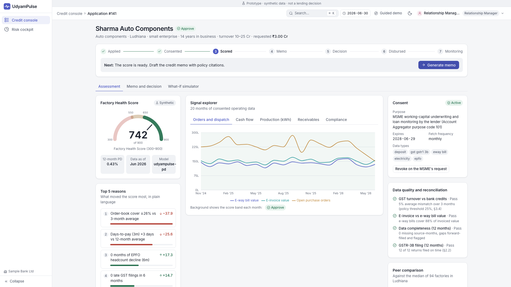

</div>

> **Status markers on every claim:** ✅ Done (built and tested) · 🟡 Partial · 🔭 Future (designed, not built).
> Numbers say where they come from: *synthetic* (our generated data), *real* (public data), *measured* or *estimate*.
> This is a prototype on synthetic data. Nothing here is a lending decision.

---

## Contents

**A · Story**
1. [Team and project](#1-team-and-project)
2. [The problem](#2-the-problem)
3. [Users and beneficiaries](#3-users-and-beneficiaries)
4. [Existing solutions and gaps](#4-existing-solutions-and-gaps)

**B · Solution**
5. [How it works](#5-how-it-works)
6. [Key features](#6-key-features)
7. [Innovation](#7-innovation)
8. [Architecture](#8-architecture)

**C · Proof**
9. [Tech stack and why](#9-tech-stack-and-why)
10. [Prototype and progress](#10-prototype-and-progress)
11. [Feasibility and plan](#11-feasibility-and-plan)
12. [Testing, validation and results](#12-testing-validation-and-results)

**D · Future and team**
13. [Scalability and sustainability](#13-scalability-and-sustainability)
14. [Risks, security and privacy](#14-risks-security-and-privacy)
15. [Expected impact](#15-expected-impact)
16. [Who built what](#16-who-built-what)

[Evaluation map](#evaluation-map) · [Quick start](#quick-start) · [FAQ for reviewers](#faq-for-reviewers) · [Acknowledgements](#acknowledgements) · [Licence](#licence)

---

# A · Story

## 1. Team and project

**UdyamPulse**, Team Legit, VIT Bhopal University.

| Member | Branch | Ownership area (PROPOSED, team to confirm) |
|---|---|---|
| _Name (to add)_ | _Branch_ | Data & ML |
| _Name (to add)_ | _Branch_ | Backend & agents |
| _Name (to add)_ | _Branch_ | Frontend & UX |
| _Name (to add)_ | _Branch_ | Deployment & docs |

| | Link |
|---|---|
| Live demo | _pending: publish with `deploy/huggingface/push.sh` (see [Deployment](docs/DEPLOYMENT.md))_ |
| Demo video | _to add_ |
| Deck | _to add_ ([outline](docs/PRESENTATION_OUTLINE.md)) |
| Repository | https://github.com/yugh88/UdyamPulse |

## 2. The problem

**Small manufacturers are lent to on stale paper and property, and their stress is spotted too late.**

- **8.7 crore** registered MSMEs, and only **41%** have ever accessed formal credit (TransUnion CIBIL–SIDBI
  *MSME Pulse*, Jul 2026).
- About **₹30 lakh crore** MSME credit gap (SIDBI).
- MSMEs make up **35.4% of manufacturing** (Union Budget 2026-27).
- **Stale-paper underwriting:**
  - Banks judge a factory on last year's audited statements and collateral.
  - Many small units have neither, even when their order book, dispatches and power use show a healthy
    business.
- **Late stress detection:**
  - Lenders learn of trouble at SMA-1/SMA-2 (30–90 days overdue), when options are fewer and costlier.
  - The early signs (falling e-way bills, power use and bank inflows) were visible months earlier.

## 3. Users and beneficiaries

| Persona | Needs | Pain today |
|---|---|---|
| **Relationship Manager** | Bring good loans in fast; know which accounts are slipping | Paper chasing; alerts without reasons |
| **Credit Officer** | Decide fast and defensibly, within policy | Rewriting memos; untraceable numbers |
| **Risk Head** | See portfolio risk; prove models are fair and auditable | Quarterly, lagging views; model-risk audits |
| **MSME owner** | Working capital without property; understand where they stand, in their language | Rejected without reasons; English-only jargon |

**Beneficiaries:**
- **Lenders:** faster decisions and earlier warnings.
- **MSMEs:** credit based on operations.
- **MSME employees:** jobs kept when stress is caught early.
- **The economy:** a smaller credit gap.

| User need | Feature | Status |
|---|---|---|
| Score without paper | Consented data pull → Factory Health Score with 5 plain-language reasons | ✅ |
| Know who is slipping, and why | Early-warning alerts with reasons and a next-best action | ✅ |
| Defensible memo, fast | Credit-memo agent with policy citations and a number guard | ✅ |
| Test scenarios | What-if simulator (read-only) | ✅ |
| Portfolio and governance view | Cockpit, model card, fairness, drift, data provenance, audit chain | ✅ |
| Owner understands, in Hindi | MSME app: readiness, cash-flow forecast, 90-day plan | ✅ |
| Owner controls data | Consent view, one-tap revoke, my-data, erasure request | ✅ |

More: [docs/USERS.md](docs/USERS.md).

## 4. Existing solutions and gaps

| Approach | What it does | Gap |
|---|---|---|
| Collateral loans + CGTMSE guarantee | Lends against property or a guarantee cover | Excludes units without property; the guarantee does not fix poor information |
| GST / bank-statement fintech scoring | Scores one or two sources at origination | Single-source (easy to inflate); little monitoring after disbursal; often a black box |
| TReDS invoice discounting | Finances invoices raised to large buyers | Only receivables from registered large buyers; not working-capital limits |
| Quarterly stock statements | Monitors drawing power through self-declared stock | Self-reported, lagging and rarely verified |
| Informal lenders | Fast money | 24–36%+ interest, no credit history built |
| **UdyamPulse** | **Reconciles GST, e-way bills, bank inflows, power and EPFO under consent; explains every score; keeps monitoring after disbursal** | **The bank decides; we make the decision faster, explainable and continuously informed** |

---

# B · Solution

## 5. How it works

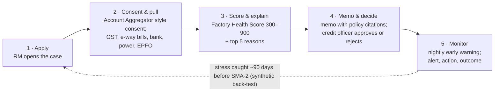

| Step | Who | Screen |
|---|---|---|
| 1–3 | Relationship Manager | 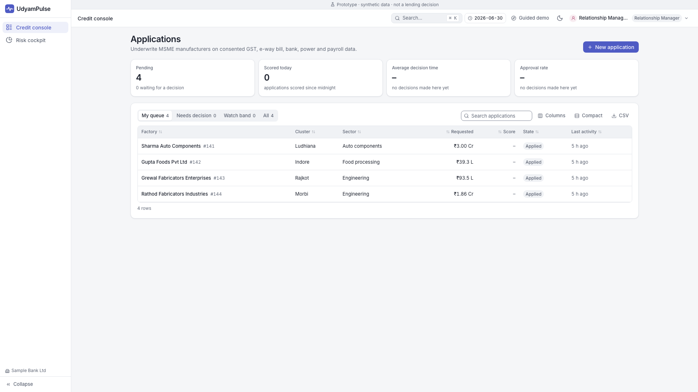  |
| 4 | Credit Officer | 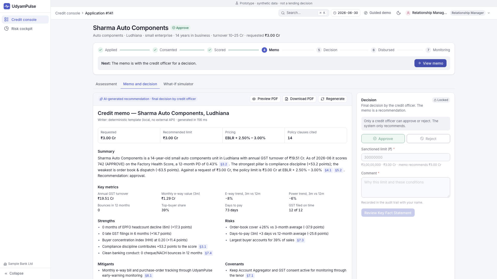 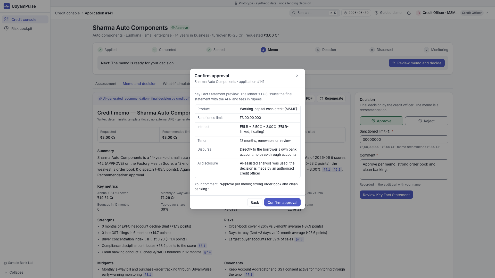 |
| 5 | Risk Head / RM | 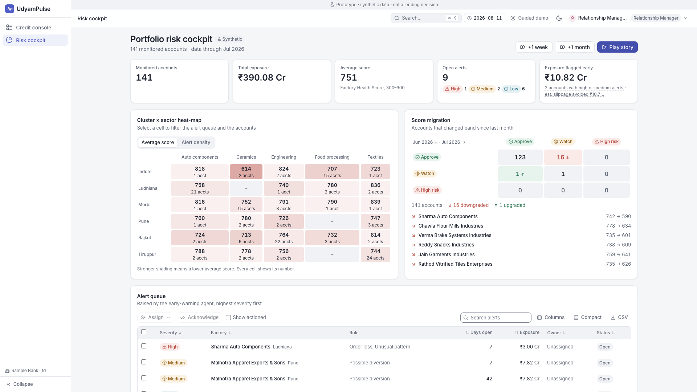 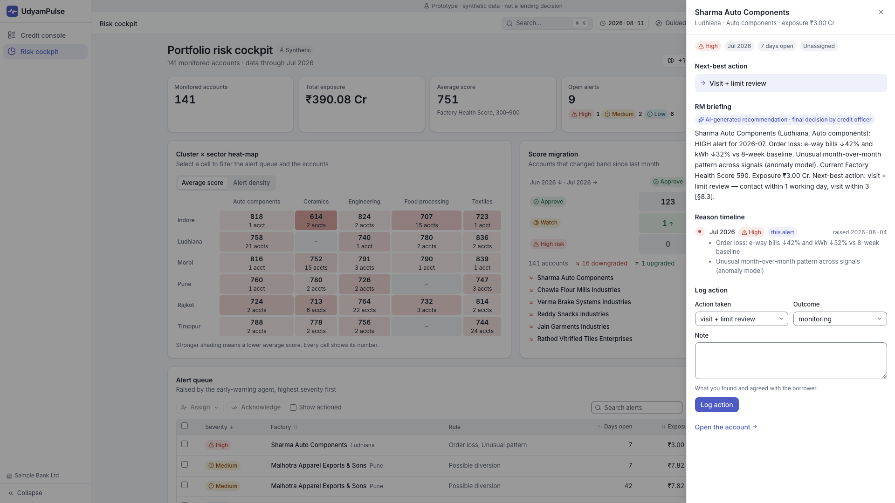 |
| Owner | MSME owner | 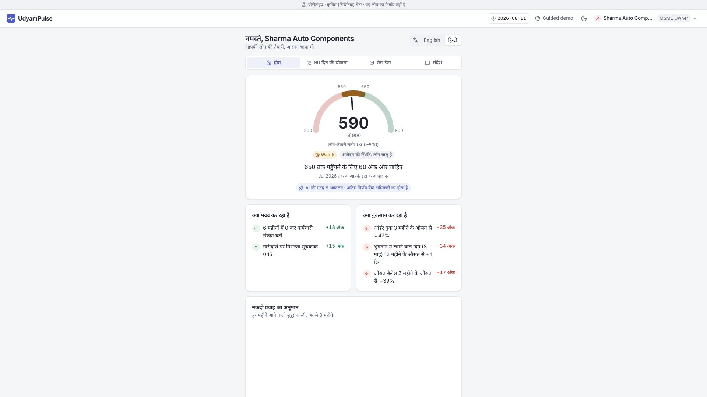 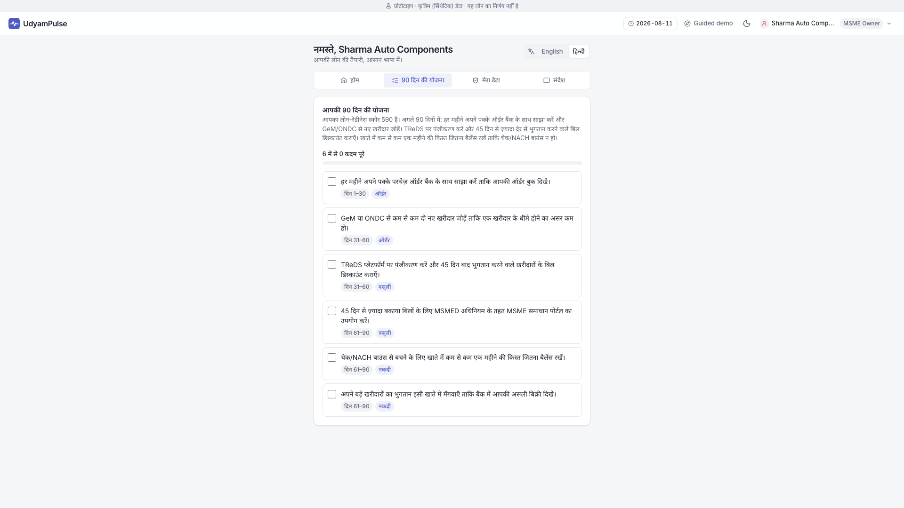 |

## 6. Key features

| Feature | What it does | Status |
|---|---|---|
| **Factory Health Score** | LightGBM PD model mapped to 300–900, with SHAP reasons in plain language, pillar points and monotone constraints, so signals move the score the sensible way | ✅ |
| **Credit-memo agent** | Drafts the memo with limit, pricing band, strengths, risks, covenants and **policy citations**; numbers come only from the engines; PDF export | ✅ |
| **Early-warning engine** | Configurable rules + IsolationForest; severity, reasons, next-best action; RM action and outcome logging | ✅ |
| **MSME advisor (Hindi)** | Readiness score, helping and hurting factors, cash-flow forecast, 90-day plan in English or हिन्दी | ✅ |
| **Consent ledger** | AA-style consent artefact, expiry, one-tap revocation that blocks pulls and deletes snapshots | ✅ (mock AA) |
| **Audit trail** | Every action and agent tool call, PII-masked, **hash-chained**, with "Verify chain" | ✅ |
| **What-if simulator** | Re-scores with changed signals; read-only and labelled as a simulation | ✅ |
| **Portfolio cockpit** | Heatmap by cluster and sector, band migration, alert queue, playable simulated clock | ✅ |
| **Governance** | Model card with CIs, fairness, drift, Data & Models provenance, AI usage log, compliance map | ✅ |
| **Guided demo mode** | 7 steps that sign in the right persona and open the right screen, with talking points | ✅ |
| Live Account Aggregator, GST and DISCOM connectors | Provider interfaces exist; live integrations need a regulated FIU partner | 🔭 |

<details>
<summary>More screenshots</summary>

| | |
|---|---|
| 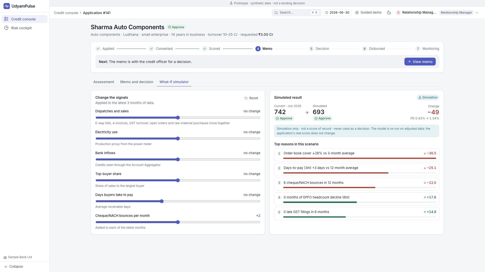 | 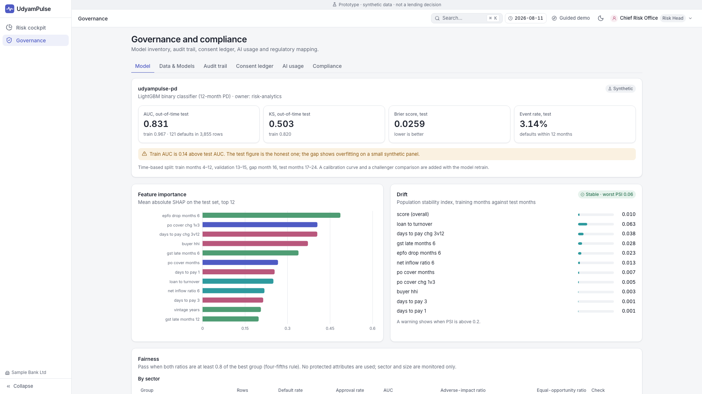 |
| 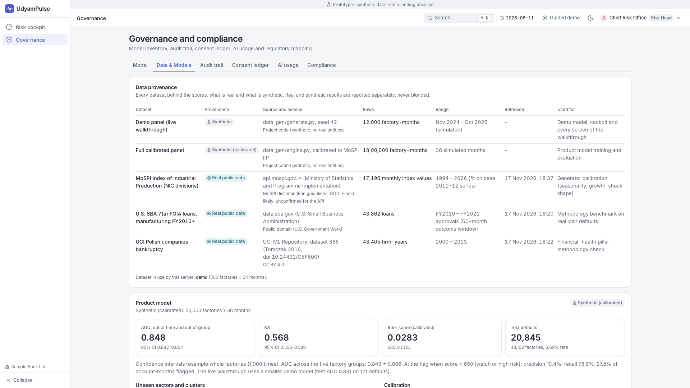 | 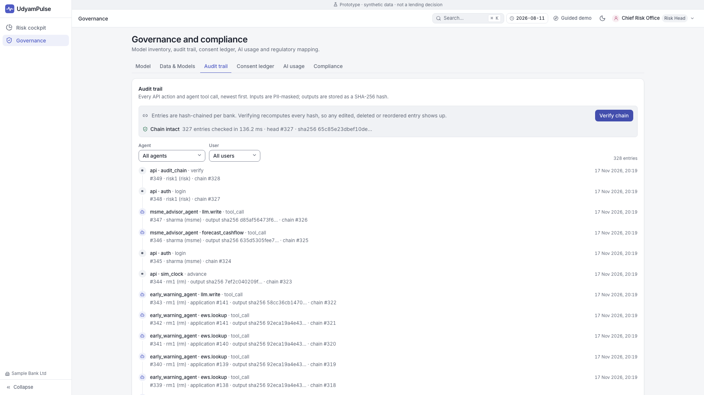 |
| 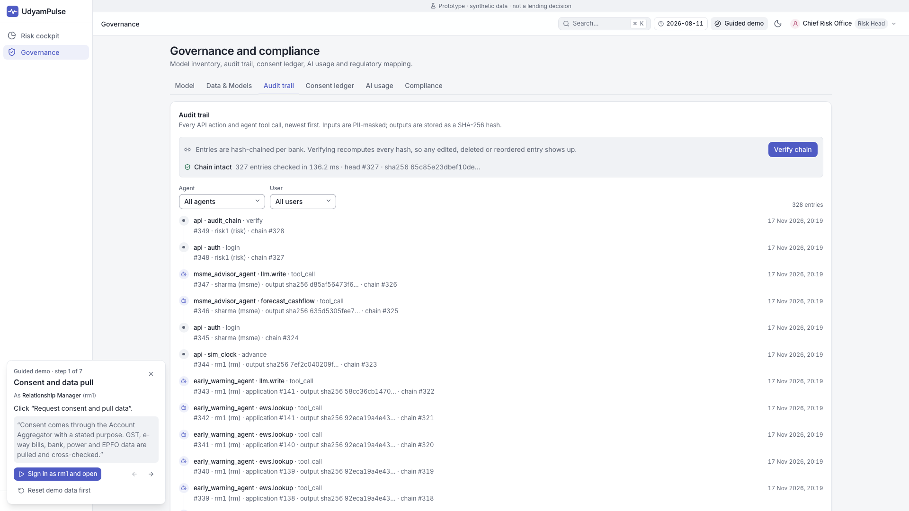 | 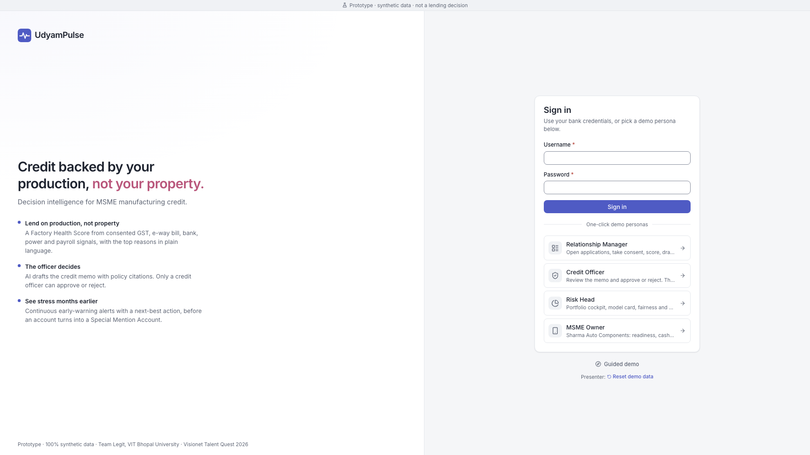 |

</details>

## 7. Innovation

- **What is new:**
  - Credit decisions and monitoring based on *how the factory runs*: dispatches, power, bank inflows, payroll
    and orders, reconciled across sources.
  - Explained in plain language and Hindi.
  - Continuous after disbursal, not only at origination.
- **UVP:** *Credit backed by your production, not your property.*
- **Innovation type:** a **new approach** (multi-source operating signals and continuous monitoring) for an
  **underserved need** (credit-invisible small manufacturers).
- **Built on India's public digital infrastructure:** Account Aggregator consent, GST e-invoicing and e-way bills,
  Udyam registration.
- **Honest by design:**
  - The LLM never produces numbers.
  - Real and synthetic results are never blended.
  - Every score is explainable and every decision is human.

**Emerging tech that could make it stronger** (🔭):
- federated learning across banks, so models improve without sharing raw data;
- ULI (Unified Lending Interface) integration;
- machine IoT signals from the shop floor;
- a voice-first vernacular advisor;
- OCEN-based embedded credit.

## 8. Architecture

### High level

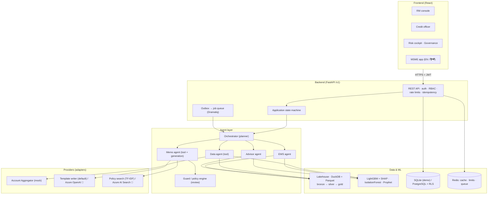

### Agent layer

| Agent | Panel role | Tools it calls | Inputs → outputs | Guardrails |
|---|---|---|---|---|
| Orchestrator | **Planner** | State machine, all agents | Application + actor → next state | Role checks; illegal transitions refused; every step audited |
| Data agent | **Tool agent** | Consent provider, lake | Consent + factory → snapshot + reconciliation checks | No pull without active consent; data minimisation |
| Scoring engine | Tool | LightGBM, SHAP | Features → PD, score, reasons | Monotone constraints; calibrated; leakage-audited |
| Memo agent | **Tool + generation** | Policy engine, policy search, LLM writer, ReportLab | Score + facts → memo + PDF | Numbers injected from engines only |
| Guard / policy engine | **Review agent** | Number guard, citation check | Draft → accepted text or template | Rejects any number not in the facts; template fallback |
| EWS agent | Monitor | Rules, IsolationForest, LLM writer | Monthly signals → alerts + briefing | Severity tiers; RM feedback logged |
| Advisor agent | Coach | Prophet forecast, SHAP | Factory → plan (EN / हिन्दी) | Recommendations only |

### How the parts talk

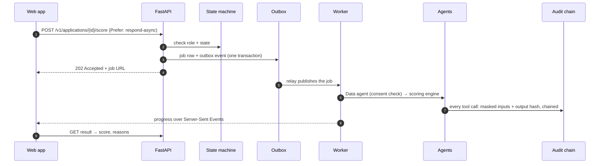

Full design, ADRs and the built-vs-future table: [docs/SYSTEM_DESIGN.md](docs/SYSTEM_DESIGN.md). Security
architecture: [docs/SECURITY.md](docs/SECURITY.md).

---

# C · Proof

## 9. Tech stack and why

| Layer | Tool | Why this, not the alternative | Status |
|---|---|---|---|
| API | **FastAPI**, Uvicorn, Pydantic | Typed, fast, automatic OpenAPI docs; chosen over Django because we need a lean API, not a CMS | ✅ |
| Persistence | **SQLAlchemy 2** + **Alembic** | One ORM for SQLite (one-command demo) and PostgreSQL (full stack), with versioned migrations | ✅ |
| Database | **SQLite → PostgreSQL 16** (psycopg 3) | SQLite needs zero setup for the demo; PostgreSQL adds row-level security for bank isolation and partitioning for scale | ✅ |
| Cache, limits, queue | **Redis** | One fast store for cache, rate limits, idempotency keys and the queue; in-memory fallback, so it is never a single point of failure | ✅ |
| Background jobs | **Dramatiq** | Simple, reliable retries and dead-lettering on Redis; lighter than Celery for our scale | ✅ |
| Lakehouse | **DuckDB + Parquet** (PyArrow) | A zero-ops local lakehouse mirroring the Databricks Delta medallion; same SQL, swaps to Databricks in production | ✅ |
| Data wrangling | **pandas**, NumPy | Standard, well understood; vectorised where scale matters | ✅ |
| PD model | **LightGBM** | Best accuracy-to-speed on tabular credit data, native missing values, monotone constraints, exact TreeSHAP; chosen over deep learning because the data is tabular and explainability is mandatory | ✅ |
| Calibration, anomalies | **scikit-learn** (isotonic, IsolationForest) | Proven, explainable building blocks for calibration and unsupervised early warning | ✅ |
| Forecast | **Prophet** | Robust monthly seasonality on short, noisy series for the MSME cash-flow forecast; fits the free tier (measured 325 MB total) | ✅ |
| Model artefacts | **joblib** | Saves the IsolationForest; native to scikit-learn | ✅ |
| Experiment tracking | **MLflow** (training only) | Local run history; not shipped in the runtime image | ✅ |
| Memo PDF | **ReportLab** | Pure-Python PDFs, no browser needed in the container | ✅ |
| Policy retrieval | **TF-IDF + NumPy cosine** | Dozens of policy clauses need exact search, not a vector index (FAISS was removed); Azure AI Search adapter for scale | ✅ / 🔭 |
| LLM writer | **Template writer** (default); **Semantic Kernel** adapters for Azure OpenAI / OpenAI | Demo needs no keys; SK is Microsoft's SDK for Azure OpenAI; cloud extras live in `requirements-cloud.txt` | ✅ / 🟡 |
| Config | **PyYAML** | Readable rules (`ml/rules.yaml`) and calibration (`data_gen/calibration.yaml`) | ✅ |
| Auth and crypto | **PyJWT**, **argon2-cffi**, **cryptography** (Fernet) | Short-lived tokens; modern password hashing (RFC 9106); field-level encryption with key rotation | ✅ |
| Observability | **Prometheus client**, **OpenTelemetry** | Open standards; dashboards and traces locally, Azure Monitor later | ✅ |
| Testing (Python) | **pytest**, **httpx** (FastAPI TestClient), **ruff**, bandit, pip-audit | Fast tests, one linter, blocking security scans | ✅ |
| Web | **React 19** + **TypeScript** + **Vite** | Mature ecosystem, fast builds, typed UI | ✅ |
| Styling | **Tailwind CSS v4** + design tokens, tailwind-merge, clsx | Consistent, themeable UI with WCAG-checked colours | ✅ |
| Components | **Radix UI**, cmdk, sonner, lucide-react | Accessible primitives (dialogs, tabs, menus), command palette, toasts, icons | ✅ |
| Data and tables | **TanStack Query / Table / Virtual** | Caching, sorting and virtualised tables for large portfolios | ✅ |
| Charts | **Recharts** | Declarative charts with accessible wrappers | ✅ |
| Routing, i18n | React Router, **i18next** | Role-guarded routes; Hindi for MSME owners | ✅ |
| Fonts | Inter, Noto Sans Devanagari (@fontsource) | Self-hosted (no third-party calls), readable Hindi | ✅ |
| Testing (web) | **Vitest**, Testing Library, **Playwright** + **axe-core**, ESLint, Prettier | Unit, browser and accessibility tests on every change | ✅ |
| Packaging | **Docker** (multi-stage, non-root), nginx | One image for the free demo; same image family for the full stack | ✅ |
| Production design | AKS (Helm, HPA, KEDA), Terraform, Key Vault, Event Hubs | Documented and validated, deliberately not deployed | 🔭 |

## 10. Prototype and progress

- **Live demo:** _link pending_. Demo personas, password `demo123`: `rm1`, `co1`, `risk1`, `sharma`.
- **Guided demo:** click **Guided demo** on the login page; 7 steps, about 5 minutes. Script:
  [docs/DEMO_SCRIPT.md](docs/DEMO_SCRIPT.md).
- **Video:** _to add_.

| Area | Done ✅ | Partial 🟡 | Future 🔭 |
|---|---|---|---|
| Lifecycle | Consent, scoring, memo, decision, disbursal stub, monitoring | KFS and LOS are stubs | Live LOS / CBS connectors |
| Data | 500-factory demo; 50,000-factory calibrated panel; SBA and UCI benchmarks | Indian GST / power statistics not yet automated | Pilot on consented real data |
| Models | Monotone LightGBM, calibration, SHAP, EWS operating point, fairness, drift, leakage audit | | Champion/challenger, scheduled retraining |
| Platform | Tenancy + RLS, jobs + outbox, SSE, caching, rate limits, security hardening, observability | | AKS autoscaling, Event Hubs, multi-region |
| Delivery | Free single-container image tested; CI with security gates; guided demo | Public URL needs the team's account | Azure pilot |

<details>
<summary>Round 2 changelog</summary>

1. **Audit:** a full audit of the Round 1 build ([docs/UPGRADE_AUDIT.md](docs/UPGRADE_AUDIT.md)).
2. **Design system and screens:** calm design system, every screen rebuilt, dark mode, Hindi, accessibility checks.
3. **Scale backbone:** multi-tenant PostgreSQL with RLS, Redis, background jobs with an outbox, SSE progress,
   cursor pagination, a chunked nightly batch.
4. **Ops and security:** OpenTelemetry and Prometheus; argon2id with rotating sessions; field encryption;
   hash-chained audit; branch-scoped access; LLM resilience; threat model; blocking CI scans.
5. **Data scale and honesty:**
   - 50,000-factory panel calibrated to MoSPI;
   - real SBA and UCI benchmarks with CIs, including a leak found in public data;
   - monotone constraints;
   - group + time evaluation;
   - Data & Models tab.
6. **Guidelines compliance:** free single-container deployment, guided demo, this README and the docs set.

</details>

## 11. Feasibility and plan

- **Build and deploy today (₹0):**
  - One Docker container (FastAPI serves the API and the React app) on a free host.
  - Measured: ready **7 s** after start, **325 MB** after the full story (512 MB cap), all browser tests pass
    against it ([docs/DEPLOYMENT.md](docs/DEPLOYMENT.md)).
- **Azure pilot (🔭):** AKS + PostgreSQL Flexible Server + Azure Cache for Redis + Key Vault in **Central India**.
  Helm chart and Terraform are written and validated, not deployed.

| Resource | Prototype | Pilot (one bank) | Production (10 lakh accounts) |
|---|---|---|---|
| Team | 4 students | 4–6 engineers + bank SMEs | Bank IT + vendor team |
| Compute | 1 free container | 3 small AKS nodes, managed PostgreSQL and Redis | 3–6 nodes, zone-redundant PostgreSQL, Premium Redis |
| Monthly cost | **₹0** | **about ₹42,000** (*estimate*) | **about ₹1–1.7 lakh** (*estimate*) |

**Roadmap (pilot → production):**
1. **Partner:** a bank registers as Account Aggregator FIU; sign the data-sharing agreements.
2. **Back-book:** score the bank's consented historical book; re-learn coefficients and thresholds; re-prove
   the uplift from production signals.
3. **Validate:** independent model validation, fairness review and model-risk approval.
4. **Shadow:** run scores in shadow for 90 days, then go live with read-only LOS integration.

Dependencies: the bank partner as FIU, data-sharing agreements, model-risk approval, GSP and DISCOM feeds.

## 12. Testing, validation and results

**Tests:**

| Layer | Count | Where |
|---|---|---|
| Backend: unit + API (SQLite) | 155 passed (+ 7 PostgreSQL-only) | `tests/` |
| Backend on PostgreSQL + Redis | 160 passed | `make test-full` |
| Web unit | 23 | `web/src/**/*.test.ts(x)` |
| Browser end-to-end (both themes, axe accessibility) | 21 (+ 1 screenshot spec run on demand) | `web/e2e/` |

CI runs all of these plus the blocking security gates: gitleaks, pip-audit, bandit, npm audit and Trivy.

**Model results, kept apart:**

| Result | Data | Value (95% CI) |
|---|---|---|
| Product model, out of time and out of group | **synthetic** (50,000 factories) | AUC **0.848** (0.842–0.854); ECE 0.012 |
| Unseen sectors / unseen clusters | synthetic | 0.814–0.864 / 0.831–0.860 |
| Early warning (alert at ≥ 3 points) | synthetic | recall 0.866, median lead **90 days**, precision 0.314 |
| Leakage audit / 8 shuffled-label runs | synthetic | passed / mean AUC 0.466, scattered around 0.5 |
| Demo model (live walkthrough) | synthetic (500 factories) | AUC 0.831 on 121 test defaults (wide interval) |
| U.S. SBA 7(a) manufacturing loans, 60-month default | **real** (public domain) | AUC **0.687** (0.658–0.713); unseen states 0.681 |
| UCI Polish bankruptcies | **real** (CC BY 4.0) | AUC **0.958** (0.952–0.964) |

- **Not inflated:** in the SBA data we found that loan term is revised for loans that go bad. With it the AUC
  read 0.915; we report 0.687.
- **Not oversold:** the +0.015 AUC from production signals reflects how the generator was built and must be
  re-proven in a pilot.

Details: [model card](ml/MODEL_CARD.md) · [data strategy](docs/DATA_STRATEGY.md) ·
[SBA report](ml/reports/real_sba_benchmark.md) · [Polish report](ml/reports/real_polish_benchmark.md).

**Performance (measured):**
- nightly batch at 915 accounts/s per process;
- portfolio read in 18–22 ms;
- 50,000-factory panel built in 2 min 12 s.

The k6 load test is still to run (🟡).

**User validation:** 0 sessions recorded (team to update). See [docs/VALIDATION.md](docs/VALIDATION.md).

---

# D · Future and team

## 13. Scalability and sustainability

- **Scaling path:**
  - stateless API → horizontal pods;
  - queue + workers;
  - month-partitioned PostgreSQL;
  - Redis cache;
  - Databricks lakehouse (🔭);
  - Kubernetes autoscaling with HPA and KEDA (🔭).
- **Capacity plan (10 lakh accounts):** the nightly batch takes about 18 min in one process, about 5 min on
  four (*estimate* from the measured 915 accounts/s). See [docs/SYSTEM_DESIGN.md](docs/SYSTEM_DESIGN.md).
- **Business model:** about ₹500 per credit memo plus ₹50 per monitored account per month, paid by the lender
  (*estimates* for discussion).
- **Operational sustainability:**
  - MLOps: model card per run, drift and fairness checks, retraining cadence and champion/challenger (🔭).
  - Monitoring: dashboards and alert rules.
- **Green compute:** nightly batch scheduling, right-sized containers (the demo fits in 325 MB), no GPU needed.
- **Next steps:**
  - 23 Nov: feature freeze.
  - 24 Nov: deployment, video and deck final.
  - After Round 2: pilot conversations with a lender.

## 14. Risks, security and privacy

| Top risk | Mitigation | Status |
|---|---|---|
| Synthetic training data | MoSPI calibration, real public benchmarks, results labelled, lender pilot | 🟡 |
| No live AA / GST access | Provider interfaces + mocks; the bank as FIU in a pilot | 🟡 |
| LLM hallucination or outage | Numbers from engines only, guard, template fallback, circuit breaker | ✅ |
| Alert fatigue | Tuned operating point (precision 0.314 at a 90-day lead, synthetic), severity tiers, feedback loop | ✅ |
| Privacy and regulation | Consent ledger, revocation, minimisation, India-only residency, PII masking, encryption | ✅ |

All 20 risks with mitigations and status: [docs/LIMITATIONS_AND_RISKS.md](docs/LIMITATIONS_AND_RISKS.md).

- **Security:**
  - argon2id passwords and 15-minute tokens with rotating refresh cookies.
  - RBAC plus branch scope, and bank isolation with PostgreSQL row-level security.
  - Field encryption, a hash-chained audit trail, rate limits and a strict CSP.
  - Blocking security scans in CI.
  - See [docs/SECURITY.md](docs/SECURITY.md) and [docs/THREAT_MODEL.md](docs/THREAT_MODEL.md).
- **Privacy:**
  - DPDP Act: purpose-bound consent, one-tap revocation with deletion, data minimisation, access and erasure
    requests.
  - India-only data residency is enforced at start-up.
  - See [docs/COMPLIANCE.md](docs/COMPLIANCE.md) and [docs/RESPONSIBLE_AI.md](docs/RESPONSIBLE_AI.md).

## 15. Expected impact

| Outcome | Number | Basis |
|---|---|---|
| Credit-memo drafting | Seconds instead of hours | *measured* in the prototype (template writer); hours today is an *estimate* from bank practice |
| Stress lead time | Median **90 days** before SMA-2 | *synthetic* back-test on 50,000 factories |
| Approval uplift for thin-file manufacturers | Target +10–15% at the same risk | *estimate*, to be proven in a pilot |
| Example ROI | 1 avoided ₹3 Cr default covers years of fees for a branch | *illustrative estimate* |
| Credit unlocked | If 1% of the ₹30 lakh crore gap moves to operating-signal lending: ₹30,000 crore | *scenario, not a forecast* |
| Jobs supported | The hero factory alone employs 118 people | *synthetic example* |

## 16. Who built what

| Member | Ownership areas | Key files | Will explain |
|---|---|---|---|
| _Name (to add)_ | Data & ML | `data_gen/`, `data_real/`, `ml/` | Data, features, model, EWS, metrics |
| _Name (to add)_ | Backend & agents | `api/`, `agents/`, `worker/` | API, agents, guard, consent, audit |
| _Name (to add)_ | Frontend & UX | `web/src/` | Screens, design system, accessibility, Hindi |
| _Name (to add)_ | Deployment & docs | `deploy/`, `.github/`, `docs/` | Deployment, CI/CD, docs, deck |

**PROPOSED, team to confirm.** Explainers per area: [docs/TEAM.md](docs/TEAM.md). Q&A prep:
[docs/QA_PREP.md](docs/QA_PREP.md).

---

## Evaluation map

| Panel criterion | Evidence | Status |
|---|---|---|
| Problem & solution fit | §2–5, [users](docs/USERS.md), [validation](docs/VALIDATION.md) | ✅ / 🟡 validation |
| Innovation & differentiation | §4, §7 | ✅ |
| Technical architecture | §8–9, [system design](docs/SYSTEM_DESIGN.md), [security](docs/SECURITY.md) | ✅ |
| Feasibility & scalability | §11, §13, [deployment](docs/DEPLOYMENT.md) | ✅ / 🟡 public URL |
| Prototype & validation | §10, §12, CI | ✅ / 🟡 video |
| Impact & team ownership | §15–16, [team](docs/TEAM.md) | 🟡 team to confirm |

Full map: [docs/EVALUATION_MAP.md](docs/EVALUATION_MAP.md).

## Quick start

```bash
git clone https://github.com/yugh88/UdyamPulse && cd UdyamPulse
make demo                      # Python 3.11 + Node 20: builds data and model, seeds, opens http://localhost:5173
```

<details>
<summary>More ways to run it</summary>

| Command | What it does |
|---|---|
| `make demo` | One command, offline, no keys: SQLite and the in-process worker |
| `make up` | Full stack in Docker: PostgreSQL, Redis, API, worker, nginx |
| `docker build -f deploy/huggingface/Dockerfile -t udyampulse-demo . && docker run -p 7860:7860 udyampulse-demo` | The free public-demo container locally (http://localhost:7860) |
| `make test` / `make test-full` / `make test-web` / `make e2e` | Test suites (SQLite / PostgreSQL + Redis / web unit / browser) |
| `make data-real && make bench-real` | Download the real public datasets and run the benchmarks |
| `make data-full && make train-full` | 50,000-factory panel and product model (about 2 + 11 minutes) |
| `make security` / `make deploy-check` | The CI security gates / Helm and Terraform validation |

</details>

## FAQ for reviewers

<details><summary><b>Is the data real?</b></summary>

The product model and the demo use synthetic data, calibrated to real MoSPI production statistics. The method is
validated on **real** public data: U.S. SBA loans (AUC 0.687) and Polish bankruptcies (0.958). The two kinds of
results are reported separately.
</details>

<details><summary><b>Why synthetic?</b></summary>

No public Indian dataset links firm-level GST, Account Aggregator or power data to loan outcomes. That data is
protected by the DPDP Act and the AA framework. A pilot with a lender, on consented data, is how accuracy gets
proven.
</details>

<details><summary><b>What happens without an LLM key?</b></summary>

Everything works. The default writer is a deterministic template. With a key, the LLM only rewrites prose, numbers
always come from the engines, and any failure falls back to the template.
</details>

<details><summary><b>How does consent work?</b></summary>

An AA-style consent artefact records purpose, data types, date range and expiry. No pull happens without an
active consent. Revocation blocks pulls and deletes stored snapshots, and every event is in the consent ledger.
</details>

<details><summary><b>What is done vs future?</b></summary>

Every claim above carries ✅ / 🟡 / 🔭. In short:
- **Done:** the full lifecycle, models, early warning, governance, security, the free-deploy image and tests.
- **Future:** live AA, GST and LOS connectors, and the Azure deployment.
</details>

## Acknowledgements

Datasets, statistics, regulations, libraries and fonts are credited in
[docs/ACKNOWLEDGEMENTS.md](docs/ACKNOWLEDGEMENTS.md). Licence inventories: [Python](docs/licenses/python-runtime.md),
[web](docs/licenses/web-direct.md). Problem framing and Round 2 guidelines: Visionet Systems.

## Licence

To be chosen by the team before submission (no `LICENSE` file yet). Third-party licences are listed above.

<div align="center"><sub>Team Legit · VIT Bhopal University · Visionet Techthon 2026</sub></div>
