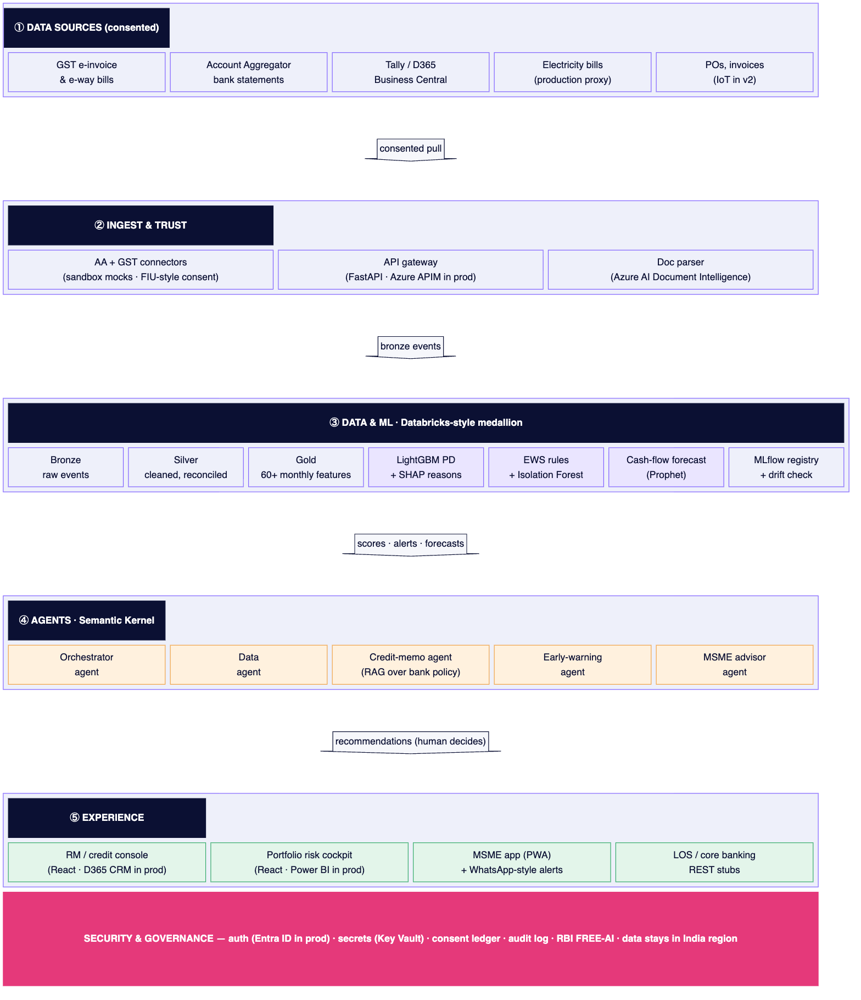
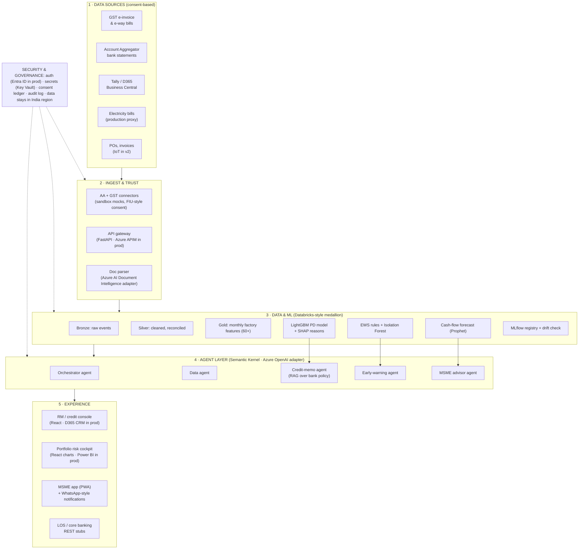
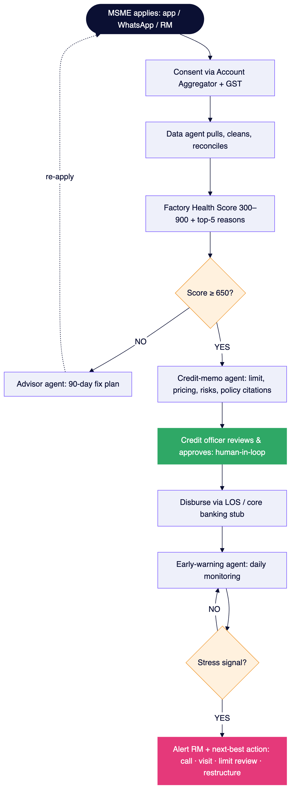
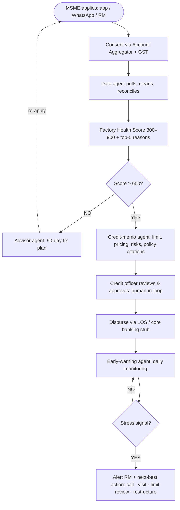

# Architecture

Rendered images: [`images/architecture.png`](images/architecture.png) · [`images/loan_lifecycle.png`](images/loan_lifecycle.png)
(SVG versions alongside). Sources: [`diagrams/`](diagrams/) — regenerate with
`npx -p @mermaid-js/mermaid-cli mmdc -i docs/diagrams/<name>.mmd -o docs/images/<name>.png -c docs/diagrams/mermaid-config.json`.

## 1. System architecture

## 2. Loan-lifecycle flowchart (what the demo walks through)

## 3. How the layers map to code

| Layer | Prototype (local default) | Code | Production adapter (behind a Protocol) |
|---|---|---|---|
| Data sources | Synthetic generator, 500 factories × 24 months, fixed seed | `data_gen/generate.py` | AA (ReBIT FIU APIs), GSTN/IRP, e-way bill, DISCOM, Tally/BC connectors |
| Ingest & trust | Mock AA consent artefacts + ledger; regex doc parser | `agents/providers/consent.py`, `docparser.py` | `SahamatiAAConsentProvider`, `AzureDocIntelParser` |
| Bronze → silver | Parquet + DuckDB SQL (dedupe, calendar spine, reconciliation) | `data_gen/lake.py` | Azure Databricks + Delta Lake + Unity Catalog (`DatabricksLakeStore`) |
| Gold features | 67 features, 1/3/6/12-month windows, five pillars | `ml/features.py` | Databricks feature tables |
| PD model | LightGBM + TreeSHAP, time split, score 300–900 | `ml/train.py`, `ml/scoring.py` | Databricks MLflow registry |
| Early warning | YAML rules + IsolationForest + lead-time back-test | `ml/ews.py`, `ml/rules.yaml` | Same code on Databricks Jobs |
| Forecast | Prophet (offline fallback) | `ml/forecast.py` | — |
| Agents | Typed classes; every tool call audited | `agents/*.py` | Semantic Kernel + Azure OpenAI / Foundry Agent Service |
| LLM | Deterministic template writer (no keys needed) | `agents/providers/llm.py` | `SemanticKernelLLM` (Azure OpenAI), guarded by `agents/guard.py` |
| RAG | TF-IDF (or sentence-transformers) + FAISS over `policy/*.md` | `agents/providers/search.py` | Azure AI Search hybrid (`AzureAISearch`) |
| API | FastAPI + Pydantic v2, JWT roles | `api/` | Azure API Management + Entra ID |
| OLTP | SQLite via SQLAlchemy | `api/models/db.py` | Azure Database for PostgreSQL |
| Experience | React + Vite + Tailwind + Recharts; PWA | `web/` | Dynamics 365 CRM embed, Power BI Embedded |

Every provider is selected by an environment variable (`UP_LLM_PROVIDER`, `UP_SEARCH_PROVIDER`,
`UP_DOC_PARSER`, `UP_CONSENT_PROVIDER`, `UP_LAKE_STORE`, `UP_EMBEDDINGS`); the default is always local.

## 4. Loan-journey state machine

`APPLIED → CONSENTED → SCORED → MEMO_DRAFTED → DECIDED → DISBURSED → MONITORING`
(`agents/orchestrator.py`). Invalid transitions return **409**; actions without active consent return **403**.

## 5. Simulated clock

The panel covers Nov 2024 – Oct 2026. The demo starts on **30 Jun 2026** with data visible through month 20.
`POST /sim/advance?days=N` moves the clock; the early-warning agent then processes every newly visible month
for monitored accounts (only those with active consent).

## 6. Guardrails that are enforced in code

- **No invented numbers:** memo and briefing numbers come from `build_facts` / the scoring engine; LLM output
  containing any number absent from the facts is rejected (`agents/guard.py`, `tests/test_memo.py`).
- **Human decision:** only `credit_officer` can call `/decision`; a comment is mandatory.
- **Consent gate:** every data pull goes through `authorise_pull`; revocation blocks pulls and runs a deletion job.
- **Audit:** every tool call writes agent, tool, PII-masked inputs, output SHA-256, user and timestamp.
- **Residency:** the API refuses to start if `UP_DATA_REGION` is a non-India cloud region.
