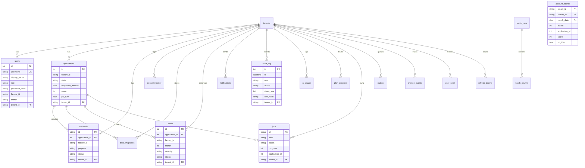

# Database Schema and Architecture

This document outlines the PostgreSQL 16 database schema for UdyamPulse. It is generated by reading the Alembic migrations (`migrations/versions/0001` to `0010`). The database enforces strict tenant isolation via PostgreSQL Row-Level Security (RLS) and uses declarative partitioning for high-volume time-series data.

## Entity-Relationship Diagram



## Table Definitions

1. **tenants**
   - **Created in:** `0001_initial.py`
   - **Purpose:** Stores the top-level tenant (e.g., a partner bank).
   - **Key Columns:** `id` (String, PK), `name` (String).
   - **RLS Policy:** None (parent table).
   - **Notes:** Migration 0010 adds `change_baseline_at` (Timestamp) to mark the end of seeded history.

2. **users**
   - **Created in:** `0001_initial.py`
   - **Purpose:** Application users (credit officers, admins).
   - **Key Columns:** `id` (Integer, PK), `username` (String, Unique), `display_name` (Text - encrypted), `role`, `password_hash`, `factory_id`, `branch`, `tenant_id` (FK).
   - **Indexes:** `ix_users_tenant_id`
   - **RLS Policy:** `tenant_isolation` (Enabled & Forced)

3. **refresh_tokens**
   - **Created in:** `0005_refresh_tokens.py`
   - **Purpose:** Rotating refresh tokens for auth. Stores only hashes.
   - **Key Columns:** `id` (String, PK), `family_id`, `username`, `token_hash`, `issued_at`, `expires_at`, `tenant_id` (FK).
   - **Indexes:** `ix_refresh_tokens_family_id`, `ix_refresh_tokens_tenant_id`, `ix_refresh_tokens_username`
   - **RLS Policy:** `tenant_isolation` (Enabled & Forced)

4. **applications**
   - **Created in:** `0001_initial.py`
   - **Purpose:** Loan applications and their current state (scoring, memo, decisions).
   - **Key Columns:** `id` (Integer, PK), `factory_id`, `state`, `score`, `pd_12m`, `memo` (JSON), `decision`, `tenant_id` (FK).
   - **Indexes:** `ix_applications_tenant_factory`, `ix_applications_tenant_state`. Migration 0008 adds cluster and `ix_applications_tenant_cluster`.
   - **RLS Policy:** `tenant_isolation` (Enabled & Forced)

5. **consents**
   - **Created in:** `0001_initial.py`
   - **Purpose:** Account Aggregator (AA) consent artefacts.
   - **Key Columns:** `id` (String, PK), `application_id` (FK), `purpose`, `fi_types` (JSON), `status`, `tenant_id` (FK).
   - **Indexes:** `ix_consents_application_id`, `ix_consents_factory_id`, `ix_consents_tenant_id`
   - **RLS Policy:** `tenant_isolation` (Enabled & Forced)

6. **consent_ledger**
   - **Created in:** `0001_initial.py`
   - **Purpose:** Append-only log of consent events (granted, revoked, expired).
   - **Key Columns:** `id` (Integer, PK), `consent_id`, `event`, `actor`, `ts`, `tenant_id` (FK).
   - **Indexes:** `ix_consent_ledger_consent_id`, `ix_consent_ledger_factory_id`, `ix_consent_ledger_tenant_id`
   - **RLS Policy:** `tenant_isolation` (Enabled & Forced)

7. **data_snapshots**
   - **Created in:** `0001_initial.py`
   - **Purpose:** Stores the raw JSON payload pulled from providers at a point in time.
   - **Key Columns:** `id` (Integer, PK), `application_id` (FK), `upto_month`, `payload` (Text - encrypted via 0006), `tenant_id` (FK).
   - **Indexes:** `ix_data_snapshots_application_id`, `ix_data_snapshots_factory_id`, `ix_data_snapshots_tenant_id`
   - **RLS Policy:** `tenant_isolation` (Enabled & Forced)

8. **alerts**
   - **Created in:** `0001_initial.py`
   - **Purpose:** Early Warning System (EWS) alerts generated for factories.
   - **Key Columns:** `id` (Integer, PK), `application_id` (FK), `severity`, `rules` (JSON), `status`, `tenant_id` (FK).
   - **Indexes:** `ix_alerts_tenant_status_severity`, `ix_alerts_tenant_id`, etc.
   - **RLS Policy:** `tenant_isolation` (Enabled & Forced)

9. **notifications**
   - **Created in:** `0001_initial.py`
   - **Purpose:** Outbound messages (e.g., WhatsApp, SMS) sent to factories.
   - **Key Columns:** `id` (Integer, PK), `factory_id`, `channel`, `text`, `text_hi`, `tenant_id` (FK).
   - **Indexes:** `ix_notifications_factory_id`, `ix_notifications_tenant_id`
   - **RLS Policy:** `tenant_isolation` (Enabled & Forced)

10. **audit_log**
    - **Created in:** `0001_initial.py`
    - **Purpose:** Immutable, hash-chained log of all system actions.
    - **Key Columns:** `id` (Integer, PK), `ts`, `user`, `action`, `chain_seq`, `prev_hash`, `row_hash` (added in 0007), `tenant_id` (FK).
    - **Indexes:** `ux_audit_log_tenant_chain_seq` (Unique), `ix_audit_log_ts`.
    - **RLS Policy:** `tenant_isolation` (Enabled & Forced)
    - **Note:** Migration 0007 adds a trigger (`audit_log_append_only`) that blocks `UPDATE` and `DELETE` on rows once `chain_seq` is set, enforcing immutability.

11. **change_events**
    - **Created in:** `0010_change_tracking.py`
    - **Purpose:** Tracks changes made to entities (e.g., application status) for the UI activity feed.
    - **Key Columns:** `id` (Integer, PK), `entity_type`, `entity_id`, `before` (JSON), `after` (JSON), `tenant_id` (FK).
    - **Indexes:** `ix_change_events_tenant_app`, `ix_change_events_tenant_entity`
    - **RLS Policy:** `tenant_isolation` (Enabled & Forced)

12. **user_seen**
    - **Created in:** `0010_change_tracking.py`
    - **Purpose:** Tracks when a user last viewed an item (for "unread" badges).
    - **Key Columns:** `id` (Integer, PK), `username`, `entity_type`, `entity_id`, `last_seen_at`, `tenant_id` (FK).
    - **Indexes:** `ux_user_seen` (Unique on tenant + username + entity)
    - **RLS Policy:** `tenant_isolation` (Enabled & Forced)

13. **ai_usage**
    - **Created in:** `0001_initial.py`
    - **Purpose:** Logs every LLM call (latency, tokens, fallback).
    - **Key Columns:** `id` (Integer, PK), `agent`, `provider`, `latency_ms`, `outcome` (added in 0009), `tenant_id` (FK).
    - **Indexes:** `ix_ai_usage_application_id`, `ix_ai_usage_tenant_id`, `ix_ai_usage_ts`
    - **RLS Policy:** `tenant_isolation` (Enabled & Forced)

14. **plan_progress**
    - **Created in:** `0001_initial.py`
    - **Purpose:** Tracks factory progress on the advisor's 90-day improvement plan.
    - **Key Columns:** `id` (Integer, PK), `factory_id`, `step_key`, `done_at`, `tenant_id` (FK).
    - **Indexes:** `ix_plan_progress_factory_id`, `ix_plan_progress_tenant_id`
    - **RLS Policy:** `tenant_isolation` (Enabled & Forced)

15. **account_scores**
    - **Created in:** `0002_partitioned_serving_and_rls.py`
    - **Purpose:** The serving table for historical scores, used for portfolio views.
    - **Key Columns:** `tenant_id` (PK), `factory_id` (PK), `month_date` (PK), `month`, `score`, `pd_12m`.
    - **Partitioning:** `RANGE` partitioned by month on `month_date`.
    - **RLS Policy:** `tenant_isolation` (Enabled & Forced)
    - **Notes:** See the dedicated section below on partitions.

16. **jobs**
    - **Created in:** `0003_jobs_and_outbox.py`
    - **Purpose:** Tracks long-running background tasks (e.g., batch scoring).
    - **Key Columns:** `id` (String, PK), `kind`, `status`, `progress`, `params` (JSON), `tenant_id` (FK).
    - **Indexes:** `ix_jobs_tenant_updated`, `ix_jobs_tenant_id`
    - **RLS Policy:** `tenant_isolation` (Enabled & Forced)

17. **outbox**
    - **Created in:** `0003_jobs_and_outbox.py`
    - **Purpose:** Transactional outbox pattern to ensure reliable event publishing.
    - **Key Columns:** `id` (Integer, PK), `topic`, `payload` (JSON), `published_at`, `tenant_id` (FK).
    - **Indexes:** `ix_outbox_unpublished`, `ix_outbox_tenant_id`
    - **RLS Policy:** `tenant_isolation` (Enabled & Forced)

18. **batch_runs**
    - **Created in:** `0004_batch_runs.py`
    - **Purpose:** Metadata for the nightly batch process.
    - **Key Columns:** `id` (String, PK), `kind`, `month`, `status`, `total_accounts`.
    - **RLS Policy:** None (Platform-level operational data, not tenant-scoped).

19. **batch_chunks**
    - **Created in:** `0004_batch_runs.py`
    - **Purpose:** Checkpoint tracking for each chunk within a batch run.
    - **Key Columns:** `run_id` (FK), `chunk_no` (PK), `shard`, `accounts`, `seconds`.
    - **RLS Policy:** None (Platform-level operational data).

20. **sim_clock**
    - **Created in:** `0001_initial.py`
    - **Purpose:** A single-row table used to store the simulated "current date" for the demo environment.
    - **Key Columns:** `id` (Integer, PK), `current_date` (Date).
    - **RLS Policy:** None.

## `account_scores` Month Partitions

Because portfolio history grows rapidly, `account_scores` is a PostgreSQL Declarative Partitioned Table.
- **Partition Key:** `RANGE (month_date)`
- **Initial Partitions:** Migration 0002 pre-creates monthly partitions from Jan 2024 to Dec 2027 (e.g., `account_scores_2024_01`).
- **Default Partition:** `account_scores_default` catches any rows that fall outside the explicit ranges.
- **Dynamic Creation:** In `api/serving.py`, the `ensure_partition` function checks if the next month's partition exists before writing scores. If it doesn't exist, it creates it on the fly (`CREATE TABLE ... PARTITION OF ...`). This ensures the batch process never fails due to a missing partition.

## Row-Level Security (RLS)

Every tenant-scoped table has RLS enabled and forced (meaning even the table owner is subject to the policy). The policy is:

```sql
tenant_id = current_setting('app.tenant_id', true) OR current_setting('app.tenant_bypass', true) = 'on'
```

The application sets `app.tenant_id` at the start of every database session (`api/tenancy.py`). This guarantees that even if a developer forgets a `WHERE tenant_id = ...` clause, the database will physically refuse to return rows belonging to another tenant.