# Database guide

The schema behind UdyamPulse: 20 tables, defined in `api/models/db.py` and created by the Alembic migrations in
`migrations/versions/` (0001–0010). The demo runs on SQLite; production runs on PostgreSQL 16, where the
row-level security and the month partitions below apply. Task A1 in [`docs/TASKS.md`](TASKS.md).

## Entity-relationship diagram

Every column of every table. A solid line is a real foreign key; a dashed line is a logical link (the same id is
stored, with no FK constraint). PNG: [`docs/images/database_er.png`](images/database_er.png).

```mermaid
erDiagram
    %% Solid line: real foreign key. Dashed line: logical link (same id stored, no FK constraint).
    tenants ||..o{ users : "tenant_id (RLS)"
    tenants ||..o{ applications : "tenant_id (RLS)"
    tenants ||..o{ consents : "tenant_id (RLS)"
    tenants ||..o{ consent_ledger : "tenant_id (RLS)"
    tenants ||..o{ data_snapshots : "tenant_id (RLS)"
    tenants ||..o{ alerts : "tenant_id (RLS)"
    tenants ||..o{ notifications : "tenant_id (RLS)"
    tenants ||..o{ audit_log : "tenant_id (RLS)"
    tenants ||..o{ ai_usage : "tenant_id (RLS)"
    tenants ||..o{ plan_progress : "tenant_id (RLS)"
    tenants ||..o{ jobs : "tenant_id (RLS)"
    tenants ||..o{ outbox : "tenant_id (RLS)"
    tenants ||..o{ change_events : "tenant_id (RLS)"
    tenants ||..o{ user_seen : "tenant_id (RLS)"
    tenants ||..o{ refresh_tokens : "tenant_id (RLS)"

    applications ||--o{ consents : "application_id"
    applications ||--o{ data_snapshots : "application_id"
    applications ||--o{ alerts : "application_id"
    applications ||..o{ jobs : "application_id"
    applications ||..o{ change_events : "application_id"

    batch_runs ||--o{ batch_chunks : "run_id"

    %% Table Definitions
    tenants {
        string id PK
        string name
        timestamp change_baseline_at
    }

    users {
        int id PK
        string username UK
        string display_name
        string role
        string password_hash
        string factory_id
        string branch
        string tenant_id "RLS"
    }

    applications {
        int id PK
        string factory_id
        string state
        string channel
        float requested_amount
        int score
        string band
        float pd_12m
        int score_month
        json score_detail
        json data_checks
        json memo
        string memo_pdf
        float recommended_limit
        string pricing_band
        string decision
        text decision_comment
        string decided_by
        timestamp decided_at
        json kfs
        float sanctioned_limit
        string disbursement_ref
        date disbursed_on
        int last_ews_month
        boolean review_requested
        text review_note
        json plan_cache
        timestamp created_at
        timestamp updated_at
        string tenant_id "RLS"
        string cluster
    }

    account_scores {
        string tenant_id PK
        string factory_id PK
        date month_date PK
        int month
        int application_id
        int score
        string band
        float pd_12m
    }

    alerts {
        int id PK
        int application_id FK
        string factory_id
        int month
        string severity
        json rules
        json reasons
        string next_best_action
        text briefing
        string status
        string action_taken
        text action_note
        string actioned_by
        string outcome
        string owner
        string acknowledged_by
        timestamp acknowledged_at
        date raised_on
        timestamp created_at
        string tenant_id "RLS"
    }

    consents {
        string id PK
        int application_id FK
        string factory_id
        string purpose
        json fi_types
        date data_from
        date data_to
        date expires_on
        string frequency
        string status
        timestamp granted_at
        timestamp revoked_at
        string tenant_id "RLS"
    }

    consent_ledger {
        int id PK
        string consent_id
        string factory_id
        string event
        json detail
        string actor
        timestamp ts
        string tenant_id "RLS"
    }

    data_snapshots {
        int id PK
        int application_id FK
        string factory_id
        int upto_month
        text payload
        timestamp pulled_at
        string tenant_id "RLS"
    }

    notifications {
        int id PK
        string factory_id
        string channel
        text text
        text text_hi
        date sim_date
        timestamp created_at
        string tenant_id "RLS"
    }

    audit_log {
        int id PK
        timestamp ts
        string user
        string role
        string agent
        string tool
        string action
        int application_id
        json inputs
        string output_hash
        string tenant_id "RLS"
        int chain_seq
        string prev_hash
        string row_hash
    }

    ai_usage {
        int id PK
        timestamp ts
        string agent
        string template_id
        string provider
        float latency_ms
        int tokens_est
        boolean fallback
        string user
        int application_id
        string tenant_id "RLS"
        string outcome
    }

    plan_progress {
        int id PK
        string factory_id
        string step_key
        timestamp done_at
        string tenant_id "RLS"
    }

    jobs {
        string id PK
        string kind
        string status
        int progress
        string message
        json params
        json result
        text error
        int attempts
        string created_by
        string role
        int application_id
        timestamp created_at
        timestamp started_at
        timestamp finished_at
        timestamp updated_at
        string tenant_id "RLS"
    }

    outbox {
        int id PK
        string topic
        json payload
        timestamp created_at
        timestamp published_at
        int attempts
        text last_error
        string tenant_id "RLS"
    }

    batch_runs {
        string id PK
        string kind
        int month
        int shards
        int chunk_size
        string status
        int total_accounts
        int total_chunks
        json stats
        text error
        timestamp started_at
        timestamp finished_at
    }

    batch_chunks {
        string run_id PK, FK
        int chunk_no PK
        int shard
        int accounts
        int alerts
        float seconds
        string worker
        timestamp finished_at
    }

    refresh_tokens {
        string id PK
        string family_id
        string username
        string token_hash
        timestamp issued_at
        timestamp expires_at
        timestamp used_at
        timestamp revoked_at
        string replaced_by
        string tenant_id "RLS"
    }

    change_events {
        int id PK
        string entity_type
        string entity_id
        int application_id
        string event_type
        json before
        json after
        string summary
        string actor
        timestamp created_at
        string tenant_id "RLS"
    }

    user_seen {
        int id PK
        string username
        string entity_type
        string entity_id
        timestamp last_seen_at
        string tenant_id "RLS"
    }

    sim_clock {
        int id PK
        date current_date
    }
```

## Keys and links

- **Foreign keys (enforced):** `consents.application_id`, `data_snapshots.application_id` and
  `alerts.application_id` → `applications.id`; `batch_chunks.run_id` → `batch_runs.id`.
- **Logical links (not enforced):** `application_id` in `change_events`, `audit_log`, `ai_usage`, `jobs` and
  `account_scores`; `username` in `refresh_tokens` and `user_seen`; `consent_id` in `consent_ledger`;
  `factory_id` in `plan_progress` and `notifications`.
- **Factories are not a table.** `factory_id` points into the DuckDB lakehouse (`lake/`), where each factory's
  profile and monthly signals live.
- **Composite primary keys:** `account_scores (tenant_id, factory_id, month_date)`;
  `batch_chunks (run_id, chunk_no)`.

## Indexes

- `applications`: `(tenant_id, state)`, `(tenant_id, factory_id)`, `(tenant_id, cluster)` for queues and branch scope.
- `alerts`: `(tenant_id, status, severity)` for the alert list.
- `audit_log`: `(tenant_id, id)` and unique `(tenant_id, chain_seq)`, so the hash chain has no gaps or duplicates.
- `change_events`: `(tenant_id, application_id, id)` and `(tenant_id, entity_type, entity_id, id)` for “What changed”.
- `user_seen`: unique `(tenant_id, username, entity_type, entity_id)`, which drives the NEW markers.
- `account_scores`: `(tenant_id, month)`; `jobs`: `(tenant_id, updated_at)`; `outbox`: `(published_at, id)`.
- `users.username` is unique; `tenant_id` and `factory_id` are indexed on every table that has them.

## Row-level security (PostgreSQL)

The 16 tables that carry `tenant_id` have `ENABLE` and `FORCE ROW LEVEL SECURITY` with one policy,
`tenant_isolation`: a row is visible only when `tenant_id = current_setting('app.tenant_id')` (migrations 0002,
0003, 0005 and 0010). `FORCE` applies it to the table owner too, and CI runs the migrations with a non-superuser
role so the policy is really enforced. `batch_runs`, `batch_chunks` and `sim_clock` are global and have no
`tenant_id`.

## Month partitions of `account_scores`

`account_scores` holds one score per monitored account per month. On PostgreSQL it is `PARTITION BY RANGE
(month_date)`, one partition per month (`account_scores_2024_01` … `account_scores_2027_12`) plus a default
partition (migration 0002). Later months are created by `api/serving.py: ensure_partition`. Month filters prune
to a single partition, and old months can be detached without touching current data
(`tests/test_postgres.py` checks the partitioning and the pruning).

## Encryption and integrity

- **Encrypted at rest (field level):** `users.display_name`, `applications.decision_comment` and `review_note`,
  `alerts.action_note`, `data_snapshots.payload` (migration 0006).
- **Hash-chained audit:** each `audit_log` row stores `prev_hash` and `row_hash` (migration 0007); “Verify
  chain” on the Governance page recomputes it.
